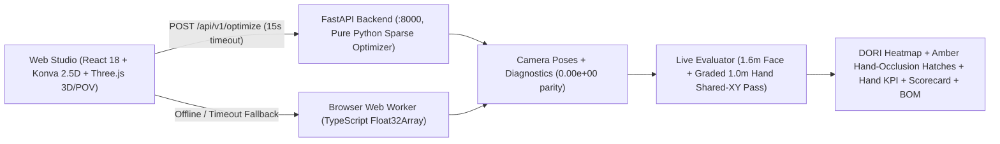

# OptiCam-Retail: Comprehensive Project Overview

**OptiCam-Retail** is a full-stack web application and 3D optimization engine that helps retail owners, engineers, and researchers design **minimum-cost, blind-spot-aware CCTV layouts** for convenience stores, mini-marts, and pharmacies.

It pairs an interactive **2.5D CAD floor planner + real-time 3D/POV simulator** with a deterministic **Two-Stage KPI-Aware Greedy + Local Search (`kpi_hybrid`)** optimizer that runs identically in both the browser (TypeScript `Float32Array` Web Worker) and the backend API (FastAPI + pure Python).

---

## 1. End-to-End Architecture & Tech Stack



| Layer | Technologies | Key Modules & Responsibilities |
|---|---|---|
| **Frontend UI** | React 18, TypeScript, Konva (`react-konva`), Three.js / React Three Fiber, Vite 8 | Two-step flow (`Mặt bằng` → `Kết quả`), 2.5D/3D synchronized editing, 6-step interactive `SpotlightOverlay` + `TutorialModal` (`?`), `CustomLayoutModal` (+ 3-step guide), polygon perimeter & `wall` builder (`W`), `rotateLayout90()`, custom `StudioSelect` popovers + segmented pills, `PlanningSettings` presets & `NumberField` steppers, click-to-place ghost (`PlacementDraft`), `CameraSchedule` mini-rail, `ShelfTierFolders` CRAVED tier UI, in-app confirmations (`pendingLayout`, `pendingConfirm`), `Inspector.tsx`, `Scorecard.tsx`, `BomModal.tsx` |
| **3D & Fixtures** | Three.js, `@react-three/fiber`, Depth-Atlas shaders | [`Store3D.tsx`](frontend/src/components/three/Store3D.tsx), [`Furniture3D.tsx`](frontend/src/components/three/Furniture3D.tsx) (`ItemShape` stock motifs), [`PersonModel3D.tsx`](frontend/src/components/three/PersonModel3D.tsx), [`CameraImageEffect.tsx`](frontend/src/components/three/CameraImageEffect.tsx), [`ObservationMaterials.ts`](frontend/src/components/three/ObservationMaterials.ts) |
| **Core Optics & Catalogs** | Pure TypeScript (`Float32Array`) | [`optics.ts`](frontend/src/core/optics.ts) (`DUAL_HEIGHT_SCORING`), [`optimizer.ts`](frontend/src/core/optimizer.ts), [`fixtures.ts`](frontend/src/core/fixtures.ts) (`13` interior subtypes + S/M/L), [`craved.ts`](frontend/src/core/craved.ts) (`16` goods categories + tier aggregation), [`geometry.ts`](frontend/src/core/geometry.ts), [`footprint.ts`](frontend/src/core/footprint.ts), [`camera.ts`](frontend/src/core/camera.ts), [`bom.ts`](frontend/src/core/bom.ts) |
| **Backend Microservice** | Python 3.11+, FastAPI, Pydantic v1, Uvicorn, OpenPyXL | [`main.py`](backend/main.py), [`greedy_optimizer.py`](backend/greedy_optimizer.py), [`footprint.py`](backend/footprint.py) |
| **Validation & Paper Suite** | Pytest, Vitest, SciPy/HiGHS, NumPy, Clarabel | [`paper_evaluation_2026-11-26/`](paper_evaluation_2026-11-26/COMPREHENSIVE_EVALUATION_OVERVIEW.md), [`frontend/experiments/`](frontend/experiments/run.ts) |

---

## 2. Two-Step Interactive Studio Workflow

1. **Step 1 — `Mặt bằng` (Floor Plan & Constraints Setup):**
   - Onboard via the **6-step interactive Spotlight Tutorial (`SpotlightOverlay` + `TutorialModal`)** triggered on first launch (`opticam.tutorial.dismissed`) and reopenable via `?` (`ArrowLeft`/`ArrowRight`/`Escape`, clickable `01`–`06` pills, try-it actions, high-contrast callout cards), plus a dedicated **3-step interactive guide** inside `CustomLayoutModal`; all destructive/reset actions use styled in-app confirmation modals (`pendingLayout`, `pendingConfirm`).
   - Switch between **18 built-in store templates**, import/export JSON bundles, or create a brand-new floor plan in **`CustomLayoutModal`** (`Chữ nhật`, `Chữ L`, `Vát góc`, `Hình thang`, or point-to-point **polygon perimeter drawing**), rotate the entire layout (`rotateLayout90()` / `Xoay 90° (R↔D)` rotating room bounds, polygons, fixtures, cameras, brush strokes, and people coherently), and sketch partition walls point-to-point via **`Dựng vách` (`W`)** (`buildWallObstacle()`).
   - Work in an expanded setup sidebar (`396 px` default / `432 px` wide / `348 px` narrow) with styled accordion cards, custom **`StudioSelect`** popovers & segmented pill bars (replacing native OS `<select>` menus), footprint presets (`5×12`, `8×8`, `10×6`, `12×8 m`), collapsible **Camera Schedule** (`190 px` ↔ `46 px` icon rail), live `NumberField` numeric steppers (`−/+`) + units, and room/ceiling/grid settings (`3–40 m`, `gridM = 0.1–2.0 m`, `30–120 px/m`, `ceilingHeight = 2.4–6.0 m`).
   - Add doors (`entrance`), checkouts (`pos`), and **13 interior fixture subtypes** (`wall-shelf`, `gondola`, `endcap`, `promo-island`, `checkout-rack`, `locked-cabinet`, `fridge`, `freezer`, `food-counter`, `seating`, `locker`, `partition`, `column`) via **click-to-place ghost preview** (`R` rotates, `Esc` cancels, **Đặt tự động** places inside free floor space).
   - Resize any selected fixture instantaneously via **S / M / L presets**, live sliders with `−/+` steppers, wall-clamped grid-free resizing (`resizeObstacle`), or the **2.5D corner resize handle** (`anchorTopLeft`), with upright `180°` flipped shelf labels.
   - Configure **stacked overlapping folder shelf tiers (`ShelfTierFolders`)**: adjust tier `zMin–zMax`, select from **16 CRAVED goods categories** (`craved.ts`), view low-tier `≤ 1.0 m` occlusion cautions, auto-compute shelf `riskCategory`/`riskWmax`, and render realistic 2.5D/3D stock geometry (`ItemShape`) plus refined anatomical human figures (`PersonNode` / `PersonModel3D`).
   - Paint manual priority overrides (`W = 5 / 3 / 1` metric strokes), place static people (`PERSON-01..N` with `0.28 m` wall/fixture clearance check and 4-region vertical inspection at `1.6 / 1.2 / 0.9 / 0.3 m`), and place/drag `wall` or `ceiling` cameras.
   - Configure mount constraints (`Tường + trần`, `Chỉ tường`, `Chỉ trần`), toggle **"Chống khuất tầm tay (1.0 m)"** (`dualHeight`, default ON), and choose camera count `1–20`.
2. **Step 2 — `Kết quả` (Live Coverage, Comparison & BOM):**
   - Inspect DORI quality heatmaps (`>= 250`, `>= 125`, `>= 62.5`, `>= 25 PPM`) and Risk zone heatmaps.
   - Spot **"Head-Only" blind spots (`1.6 m` visible, `< 1.0 m` occluded)** via amber diagonal hatches on DORI cells plus **`handCoverage` (`>= 62.5 PPM` at `1.0 m`, `80%` target)** and `headOnlyPct` readouts in `Scorecard.tsx`.
   - Toggle **"Trước tối ưu" / "Sau tối ưu"**, compare against manual 4-corners and unweighted baselines, inspect camera schedules/POV in 3D, and export **BOM CSV** or project JSON.

---

## 3. Optical Model, Dual-Height (`1.6 m + 1.0 m`) Check & Optimization Engine

### 3.1 3D Pinhole Projection & Occlusion ([`optics.ts`](frontend/src/core/optics.ts))
- For a camera at $(x_c, y_c, H_c)$ aimed at $(\text{pan}, \text{tilt})$ with horizontal resolution `res`, horizontal `fov`, 16:9 vertical `vfov`, and `range`, a cell at $(x, y, Z)$ is projected into the camera's local frame `(along, depth, right, up)`:
  - Range check: $0.03\text{ m} \le r = \sqrt{\Delta x^2 + \Delta y^2 + (Z - H_c)^2} \le \text{range}$.
  - Frustum check: $\text{depth} > 0$, $|\text{right}| \le \text{depth} \tan(\text{fov}/2)$, $|\text{up}| \le \text{depth} \tan(\text{vfov}/2)$.
  - Polygon & 3D Ray-AABB check: verifies segment $(x_c, y_c) \to (x, y)$ stays inside `floorPolygon` and passes **above** any blocker obstacle's top elevation `o.elev` (`min(z_enter, z_exit) > o.elev`). Entrances (`type = 'entrance'`) do not block sightlines.
- Pixel density: $\text{PPM} = \frac{\text{res}}{2\,r \tan(\text{fov}/2)}$, mapped onto **IEC 62676-4 DORI** utility $F(p) \in \{1.00, 0.75, 0.40, 0.20, 0.00\}$ at `{250, 125, 62.5, 25} PPM`.

### 3.2 Graded Dual-Height Occlusion Check (`1.6 m` Face + `1.0 m` Hand, `DUAL_HEIGHT_SCORING`)
- **Shared-XY Optimization (`dualPpmAt()`):** Checks `targetHeight` (`1.6 m`) and `handHeight = min(targetHeight, 1.0 m)` inside the **same 2D floor polygon & XY ray-AABB intersection loop**—adding `< 5%` compute cost instead of doubling raycasts.
- **Diagnostic (Always On):** Flags cells with `facePpm >= 25` and `handPpm < 25` as `headOnly`, rendering amber diagonal hatches on the heatmap and reporting `headOnlyPct`, `headOnlyCells`, and **`handCoverage`** (`%` of valid cells reaching `>= 62.5 PPM` at `1.0 m`, target `80%`) in `Scorecard`.
- **Graded Partial-Credit Guard (`dualHeight = true`, Tuned Across 18 Store Layouts):** Instead of a harsh binary cutoff on every aisle cell, low-zone clarity scales DORI utility continuously at cells with weight `W >= minWeightForHandCheck` (`3.0`):
  - **Hand Multiplier (`handVisibilityMultiplier`):** `>= 125 PPM -> 1.00`, `>= 62.5 PPM` (`DORI_MIN.observation`) `-> 0.85`, `>= 25 PPM -> 0.50`, `< 25 PPM -> 0.00`.
  - **Weighted Dual Blending (`dualEffectiveFactor`):** Low-priority walkways (`W < 3.0`) use pure face utility `F(face)`. High-priority **Red** zones (`W >= 4.0`) blend `0.65 * F(face) + 0.35 * min(F(face), F(face) * M_hand)`; **Yellow** shelf/counter aisles (`3.0 <= W < 4.0`) blend `0.80 * F(face) + 0.20 * min(F(face), F(face) * M_hand)`.
  - **Headline Face Metrics + Hand KPI:** Red Zone `>= 250 PPM` and Yellow Zone `>= 125 PPM` continue measuring `1.6 m` head-level clarity (no false Red failure when a `1.1 m` POS desk shields `1.0 m`), while **`handCoverage` (`1.0 m >= 62.5 PPM`)** explicitly tracks low-tier reachability (`80%` target). Both TS and Python mirror this identically (`0.00e+00` parity).

### 3.3 Live Optimization Algorithm (`kpi_hybrid` + Dedicated Min-`K`)
1. **Bounded Pool Generation:** Samples wall poses (`height ∈ [1.8, ceilingHeight - 0.3]`, tilts `{20°, 5°, 35°}`) and ceiling poses (`ceilingHeight - 0.15`, tilts `{35°, 55°, 75°, 90°}`), `30°` azimuth increments, spaced at `max(gridM, 0.5 m)` and capped at `min(12,000, floor(1,500,000 / |free|))` per unique camera profile (`prepareCandidateGroups`).
2. **Backend Acceleration ([`greedy_optimizer.py`](backend/greedy_optimizer.py)):** Pre-compiles obstacle AABBs and camera trig once per call, fast-paths convex `floorPolygon`s (`point_in_floor` once per camera), and operates over merged sparse `nz_dual` `(j, factor, face_f, tie)` tuples without per-candidate dict allocations.
3. **Two-Stage KPI Construction (`solvePrepared`):**
   - **Stage 1 (`slot < max(1, ceil(0.67 * K))` while `Red% < 95%`):** Maximizes $\Delta_{\text{Red}} \cdot \frac{\sum W_j}{\max(1, |\text{Red}|)} + 0.1\,\Delta W$, locking in cashier/entrance Face ID before aisles dilute greedy gain.
   - **Stage 2 + 3-Pass 1-Swap Polish:** Maximizes $\Delta W + (H(\text{base}) - H(\text{base} \cup c))$ with hinge penalties $\lambda_{\text{Red}} = 1.5, \lambda_{\text{Yel}} = 0.75$, and **`lambdaHand = 0.50`** (`handTargetPct = 80`, active when `dualHeight = true`) for shortfalls below `(95% Red, 80% Yellow, 80% Hand 1.0 m)`, breaking ties via nominal PPM (`<= 250`).
4. **Dedicated Per-`K` Sizing (`minimumCamerasForTargets`):** Reuses one candidate pool across `count = 1..maxK` and solves each `K` independently until `Red >= 95%` and `Yellow >= 80%`.

### 3.4 BOM Estimation Formula ([`bom.ts`](frontend/src/core/bom.ts))
- NVR placed at POS center (or `(0, 0)` fallback): $\text{Cable}_i = \lceil 1.1 \times (|x_i - x_N| + |y_i - y_N| + H_i + 3\text{ m}) \rceil$, cost heuristic `N_cam × 1,250,000 + 1,500,000 VND`.

---

## 4. Complete Inventory of All 18 Built-In Store Layouts (`data_samples/`)

| Group | File | Display Name | Size / Geometry | Fixtures | People |
|---|---|---|---|---:|---:|
| Baseline 1 | [`store_60m2.json`](data_samples/store_60m2.json) | Layout 1: Chuẩn 60 m² | `10 × 6 m` Rect | 5 | 0 *(baseline test)* |
| Baseline 2 | [`circle_k_75m2.json`](data_samples/circle_k_75m2.json) | Layout 2: Circle K 75 m² | `12.5 × 6 m` Rect | 6 | 7 |
| Baseline 3 | [`ministop_50m2.json`](data_samples/ministop_50m2.json) | Layout 3: MiniStop 50 m² | `8.5 × 6 m` Rect | 4 | 5 |
| VN 01 | [`vn_nha_ong_72m2.json`](data_samples/vn_nha_ong_72m2.json) | Nhà ống 72 m² | `5 × 14.4 m` Tube | 13 | 7 |
| VN 02 | [`vn_goc_pho_78m2.json`](data_samples/vn_goc_pho_78m2.json) | Góc phố vát góc 78 m² | `10 × 8 m` Chamfer | 14 | 7 |
| VN 03 | [`vn_chu_l_70m2.json`](data_samples/vn_chu_l_70m2.json) | Mặt bằng chữ L 70 m² | `10 × 9 m` L-Shape | 12 | 7 |
| VN 04 | [`vn_hinh_thang_67m2.json`](data_samples/vn_hinh_thang_67m2.json) | Mặt bằng hình thang 67,5 m² | `9 × 9 m` Trapezoid | 12 | 6 |
| VN 05 | [`vn_co_nguoi_78m2.json`](data_samples/vn_co_nguoi_78m2.json) | Cửa hàng giờ cao điểm 78 m² | `10 × 8 m` Chamfer | 14 | 7 |
| VN 06 | [`vn_sieuthi_mini_96m2.json`](data_samples/vn_sieuthi_mini_96m2.json) | Siêu thị nhà ống 5×12m (`60 m²`) | `5 × 12 m` Tube | 8 | 7 |
| VN 07 | [`vn_24h_cafe_84m2.json`](data_samples/vn_24h_cafe_84m2.json) | Cửa hàng 24h & F&B (`80 m²`) | `10 × 8 m` Rect | 10 | 9 |
| VN 08 | [`vn_nha_thuoc_66m2.json`](data_samples/vn_nha_thuoc_66m2.json) | Nhà thuốc & Dược mỹ phẩm (`64 m²`) | `8 × 8 m` Rect | 8 | 8 |
| VN 09 | [`vn_chu_l_ngatu_88m2.json`](data_samples/vn_chu_l_ngatu_88m2.json) | WinMart+ Nhà ống 5×15m (`75 m²`) | `5 × 15 m` Tube | 8 | 9 |
| VN 10 | [`vn_tram_xang_90m2.json`](data_samples/vn_tram_xang_90m2.json) | Mini-Mart 3 dãy & Kho góc (`96 m²`) | `12 × 8 m` Rect | 10 | 10 |
| VN 11 | [`vn_goc_vat_2cot_102m2.json`](data_samples/vn_goc_vat_2cot_102m2.json) | Góc ngã tư chữ L 2 cửa (`88 m²`) | `11 × 9 m` L-Shape | 10 | 9 |
| VN 12 | [`vn_thuc_pham_sach_77m2.json`](data_samples/vn_thuc_pham_sach_77m2.json) | Cửa hàng trạm dừng 15×6m (`90 m²`) | `15 × 6 m` Wide | 10 | 10 |
| VN 13 | [`vn_van_phong_pham_80m2.json`](data_samples/vn_van_phong_pham_80m2.json) | Góc vát 2 cột chịu lực (`105 m²`) | `12 × 9 m` Chamfer | 11 | 11 |
| VN 14 | [`vn_mat_tien_xeo_85m2.json`](data_samples/vn_mat_tien_xeo_85m2.json) | Mặt tiền xéo hình thang (`85 m²`) | `11 × 8.5 m` Trapezoid | 9 | 8 |
| VN 15 | [`vn_sieu_thi_chu_u_108m2.json`](data_samples/vn_sieu_thi_chu_u_108m2.json) | Siêu thị chữ U có vách kho (`108 m²`) | `12 × 9 m` Rect | 12 | 12 |

---

## 5. Testing, Commands & Scientific Verification

```powershell
# Run Backend API (port 8000) & Frontend Dev Server (port 3000)
.\backend\.venv\Scripts\python.exe -m uvicorn backend.main:app --host 127.0.0.1 --port 8000
cd frontend; npm.cmd run dev

# Verified Quality Checks
cd frontend; npm.cmd run build                                  # tsc --noEmit && vite build (✓ 1.07s)
cd frontend; .\node_modules\.bin\vitest.cmd run --testTimeout=15000  # 24 files, 270 tests passed
.\backend\.venv\Scripts\python.exe -m pytest backend\tests       # 62 tests passed (0.00e+00 parity)
```

### Summary of Empirical Validation ([`paper_evaluation_2026-11-26/`](paper_evaluation_2026-11-26/COMPREHENSIVE_EVALUATION_OVERVIEW.md))
- **Exact Global Optimality (`51` HiGHS MILP tests):** Reaches **`99.19%` (`Dev 7`)** and **`98.82%` (`Held-Out 15`)** of exact global optimal / LP-dual bounds (`0.00e+00` verified against brute-force).
- **Cross-Paper Benchmark (`50` unseen stores):** Sweeps `Erdem-06`, `Aziz-24`, `Kim-19`, and `Wang-13` **`50 wins – 0 losses`** ($p_{\text{Holm}} < 10^{-6}$, rank-biserial $r = 1.000$).
- **Live `kpi_hybrid` Impact (`1.6 m`):** Raises `Red >= 95% & Yellow >= 80%` pass rate from **`38% → 98%` (`49/50`) at `3` cameras** and **`80% → 100%` (`50/50`) at `4` cameras**, cutting average required cameras to **`2.48–2.57`** (vs `4.52` old slicer).
- **18-Store Dual-Height (`1.6 m + 1.0 m`) Fine-Tuning Sweep (2026-11-27):** Replaces the legacy binary cliff (`8/18 = 44.4%` KPI pass, `meanMinK = 3.94`) with tuned graded scoring (`minW=3.0, redFaceShare=0.65, yellowFaceShare=0.80, handMinPpm=62.5, target=80%, lambdaHand=0.50`), lifting KPI pass rate to **`17/18` (`94.4%`)**, achieving the highest **`98.7%` Red-zone `1.0 m` hand coverage** (vs `93.8%` face-only), cutting head-only blind gaps by **`44%` (`11.8% → 6.6%`)**, and lowering `meanMinK` back to **`3.33`**.
- **Further Reading:** [Customer Guide](paper_evaluation_2026-11-26/ABSTRACT_CUSTOMER.md) | [Professor Defense Guide](paper_evaluation_2026-11-26/ABSTRACT_PROFESSOR.md) | [References & Citations](REFERENCES.md)
