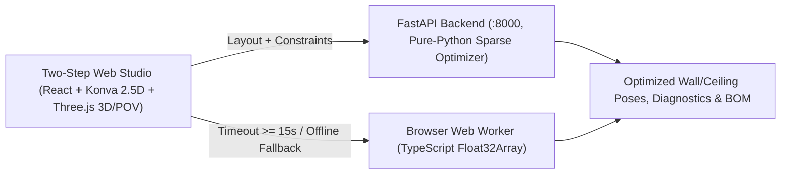

# OptiCam-Retail: Comprehensive Project Overview

**OptiCam-Retail** is a full-stack web studio and algorithmic framework for **3D risk-aware CCTV camera placement in convenience stores and mini-marts**. It combines interactive 2.5D CAD floor-plan editing, real-time 3D/POV simulation, IEC 62676-4 DORI pixel-density analytics, dual-height (`1.6 m` Face + `1.0 m` Hand) occlusion inspection, and a fast **Two-Stage KPI-Aware Greedy + Local Search (`kpi_hybrid`)** optimizer.

---

## 1. System Architecture & Live Features

- **Two-Step Guided Workflow (`Mặt bằng` → `Kết quả`):**
  - **Step 1 (`Mặt bằng`):** Edit room dimensions, grid spacing (`gridM`), ceiling height (`2.4–6 m`), polygon outlines (rectangle, L-shape, trapezoid, chamfered corner), fixtures (`pos`, `entrance`, `wall-shelf`, `gondola`, `fridge`, `freezer`, `food-counter`, `seating`, `partition`, `column`), static evaluators (`people`), manual risk brush (`W = 5 / 3 / 1`), and camera placement (`wall` or `ceiling`). Switching layouts triggers an in-app confirmation modal (*"Thay đổi mặt bằng cửa hàng?"*) to prevent accidental data loss.
  - **Step 2 (`Kết quả`):** Inspect live DORI clarity heatmaps, Risk zone heatmaps, Scorecard KPI gauges (`Red >= 250 PPM` target `95%`, `Yellow >= 125 PPM` target `80%`), before/after comparison, 3D camera POV view, and Bill of Materials (`BOM` CSV & JSON bundle export).
- **Dual-Height Occlusion Detection & Guard (`1.6 m` Face + `1.0 m` Hand):**
  - `dualPpmAt()` shares one 2D floor-polygon & ray-AABB pass to evaluate both face height (`1.6 m`) and hand/product height (`1.0 m`).
  - **Automatic Warning Overlay:** Floor cells visible at `1.6 m` (`>= 25 PPM`) but occluded below `1.6 m` (`< 25 PPM` at `1.0 m`) are marked with **amber diagonal hatches** on the DORI heatmap and summarized in `Scorecard`.
  - **Optional Enforcement (`Chống khuất tầm tay (1.0 m)` / `dualHeight`):** Enforces `1.0 m >= 125 PPM` on Red zones and `min(1.6 m, 1.0 m)` on Yellow shelves during optimization across both TypeScript and Python.

---

## 2. Optimization Engine (`kpi_hybrid` + Dedicated Min-`K`)

1. **Candidate Pool (`buildCandidates` / `prepareCandidateGroups`):**
   - Samples deterministic wall anchors (`height ∈ [1.8, ceilingHeight - 0.3]`, tilts `{t, t ± 15°}`) and ceiling grid anchors (`height = ceilingHeight - ceilingDrop`, tilts `{35°, 55°, 75°, 90°}`) with `30°` pan step, bounded by `min(12,000, floor(1,500,000 / |free|))` per unique camera profile.
   - Backend [`greedy_optimizer.py`](backend/greedy_optimizer.py) pre-compiles obstacle AABBs and camera trigonometry, uses a convex-polygon fast path, and evaluates sparse visible-cell indices (`~4.2x` speedup vs naive loop).
2. **Two-Stage Construction + Hinge Local Search (`kpi_hybrid`, live default):**
   - **Stage 1 (`slot < max(1, ceil(0.67 * K))` while `Red% < 95%`):** Prioritizes Red critical zones (`>= 250 PPM`) to prevent aisle dilution under tight `K = 3` budgets.
   - **Stage 2 & 3-Pass 1-Swap Polish:** Optimizes weighted IEC DORI utility (`[1.00, 0.75, 0.40, 0.20, 0.00]`) plus KPI shortfall hinge (`λ_Red = 1.5, λ_Yel = 0.75`).
3. **Dedicated Per-`K` Sizing (`minimumCamerasForTargets`):**
   - Reuses one precomputed candidate pool to solve `count = 1..maxK` independently until `Red >= 95%` and `Yellow >= 80%`, cutting hardware need vs post-hoc prefix slicing (`2.48–2.57` avg cameras vs `4.52`).

---

## 3. Store Templates (`18` Built-In Layouts in `data_samples/`)

- **Core Baselines (`3`):** `store_60m2.json` (`60 m²`), `circle_k_75m2.json` (`75 m²`), `ministop_50m2.json` (`50 m²`).
- **Original Retail Templates (`VN 01` – `VN 05`):** *Nhà ống 72 m²*, *Góc phố 78 m²*, *Chữ L 70 m²*, *Hình thang 67.5 m²*, and *Giờ cao điểm 78 m²* (all populated with static `people`).
- **Redesigned Vietnamese Retail Showcase (`VN 06` – `VN 15`):** Modeled on authentic Vietnamese convenience/pharmacy/mini-mart standards (`1.2–1.5 m` entry buffer, front POS + F&B counter, `1.45 m` central gondolas, shallow `0.42–0.45 m` wall shelves, rear coolers with `>= 1.0 m` door clearance, backroom partitions, window seating, and `7–12` scattered people per store).

---

## 4. Scientific Validation & Quality Verification

- **Automated Test Suites (Verified Current):**
  - **Frontend Build:** `tsc --noEmit && vite build` (`✓ built in 1.10s`)
  - **Frontend Tests:** `23` test files, `255` tests passing in Vitest (including dual-height `1.45 m` shelf occlusion, 3D geometry parity, layout round-trips, and UI workflow).
  - **Backend Tests:** `62` tests passing in Pytest (`test_api.py`, `test_ceiling_optimizer.py`, `test_retail_layouts.py`, exact `0.000000` TS–Python parity).
- **Scientific Benchmarks ([`paper_evaluation_2026-11-26/`](paper_evaluation_2026-11-26/COMPREHENSIVE_EVALUATION_OVERVIEW.md)):**
  - **Optimality vs Exact HiGHS MILP (`51` cases):** `99.19%` (`Dev 7`) and `98.82%` (`Held-Out 15`), running `399–672x` faster than exact MILP (vectorized solver).
  - **Unseen Generalization (`N = 50` stores):** `100%` (`50/50`) KPI pass at `K = 4`, `98%` (`49/50`) at `K = 3`, sweeping 4 literature baselines `50–0–0` ($p_{\text{Holm}} < 10^{-6}$, $r = 1.000$).
  - **Audience Guides:** [Customer Guide](paper_evaluation_2026-11-26/ABSTRACT_CUSTOMER.md) | [Professor Defense Abstract](paper_evaluation_2026-11-26/ABSTRACT_PROFESSOR.md) | [Citations](REFERENCES.md)
