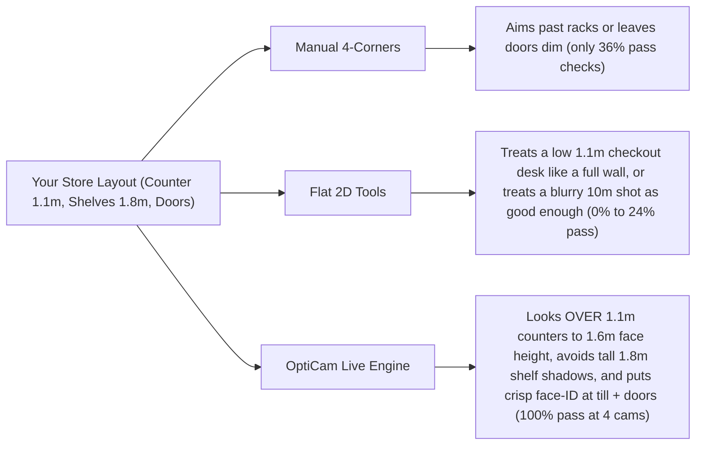
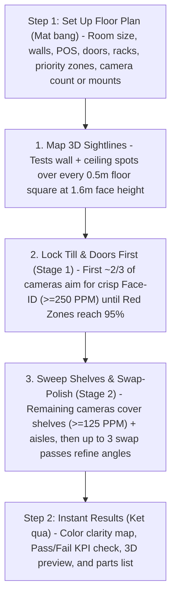

# OptiCam Store Guide: How Our Camera Planner Protects Your Shop With Fewer Cameras

> **The Bottom Line for Store Owners**  
> **OptiCam** turns your shop's floor plan into a tested CCTV blueprint in **under 0.2 seconds** in the browser/vectorized engine (or **~8.5 seconds** on the uncached pure-Python backend). Across **7 real store layouts** and **50 unseen test stores**, OptiCam passes strict cashier-ID and shelf security checks on **`98%` of stores using just 3 cameras** (`49/50`), **`100%` using 4 cameras** (`50/50`), and averages only **`2.48–2.57` cameras** to secure an entire convenience store (`50–80 m²`)—cutting hardware cost compared to manual guesswork (`4` corners) or legacy software (`4.5–10+` cameras).

---

## 1. Why Standard Camera Quotes Often Leave Blind Spots

Most installers either **stick 4 cameras in the 4 room corners** or use flat 2D calculators. In a real convenience store, both fail for three everyday reasons:



---

## 2. How OptiCam Actually Works Today (Step by Step)

OptiCam runs in two quick user steps inside the web studio (`Mặt bằng` -> `Kết quả`), powered by our newly promoted **Two-Stage KPI Engine (`kpi_hybrid`)**:



### What Happens Behind Each Button You Click:
1. **"Tối ưu vị trí" (Optimize Fixed Count `K` Cameras):**
   - Evaluates thousands of candidate wall (`1.8 m` to `ceiling - 0.3 m`) and ceiling (`ceiling - 0.15 m`) mounting spots in `0.5 m` steps and `30°` aiming angles—checking in 3D whether tall racks (`~1.8 m`) block view lines while low checkout counters (`~1.1 m`) let cameras see straight over to customers' faces (`1.6 m`).
   - Instead of chasing easy empty floor tiles first, **Stage 1** dedicates the first `ceil(0.67 * K)` camera slots to hitting **`>= 95%` crystal-clear Face-ID** at cashiers and doors. Then **Stage 2** + up to **3 quick replacement passes** balance shelves and walkways (`~83–115 ms` total).
3. **Sweep Shelves & Swap-Polish (Stage 2) + Hand-Height Guard (`1.0 m`):** Remaining cameras cover shelves (`>= 125 PPM`) and walkways (`>= 25 PPM`), then up to `3` swap passes refine placement. Whenever a `1.45 m` rack or `1.1 m` counter hides hands at `1.0 m`, OptiCam flags **amber diagonal hatches** on the map—and turning on **"Chống khuất tầm tay (1.0 m)"** forces cameras to see hands too!
4. **"Giảm số camera theo KPI" (Auto-Find Minimum Cameras):**
   - Tests a fresh layout separately for `1` camera, then `2`, `3`, `4`... and stops at the exact **smallest camera budget** that passes both security rules (`Red >= 95%` and `Yellow >= 80%`).
   - Previously, slicing `3` cameras out of a `6`-camera plan wasted hardware (`4.52` cameras average). Optimizing each count cleanly cuts average hardware need down to **`2.48` cameras** on `50` unseen test stores (`2.57` on `7` real retail templates).

---

## 3. Plain-English Guide: Why Did We Choose These Exact Numbers?

Every setting inside OptiCam comes from international CCTV standards and head-to-head stress testing across 57 stores (`7` real designs + `50` randomized store layouts) using a standard **4 MP Dome camera (`2560 px`, `85°` wide lens, `10 m` range)**:

### A. Why `250 / 125 / 62.5 / 25` Image Sharpness Levels (IEC 62676-4 DORI Standard)?
Not all camera coverage is equal. Seeing that *someone walked down an aisle* is very different from *recognizing a suspect's face at the register*:

| Sharpness Tier (IEC 62676-4) | Pixels Per Meter (PPM) | What You Can Actually See | Where OptiCam Uses It & Score Weight |
|---|---:|---|---|
| **Identification (`Red` goal)** | `>= 250 PPM` | Facial details, bills, receipts, unmistakable ID | Cash register & entrance doors (**`1.00`** full credit) |
| **Recognition (`Yellow` goal)** | `125 – 249 PPM` | Hand movements, items grabbed off shelves | Merchandise aisles & shelves (**`0.75`** credit) |
| **Observation** | `62.5 – 124 PPM` | Crowd flow, direction of walking, clothing | Walkways & transitions (**`0.40`** credit) |
| **Detection** | `25 – 62.4 PPM` | Knowing a person entered a zone | Open floor & corners (**`0.20`** credit; `< 25` = Blind `0`) |

---

### B. Why Store Priority Weights `5 : 3 : 1` (and Shelf Values `4.5 / 3.0 / 1.8`)?
When you only have 3 or 4 cameras, every zone cannot be treated equally. We tested weighting schemes from flat `(1, 1, 1)` up to extreme `(12, 3, 1)` across `50` unseen stores:

```text
Priority Score     Store Area                           Why This Level?
-----------------------------------------------------------------------------------------
Weight 5   (Red)   Cash Register (POS) & Doors          Cash handling + entry/exit choke point
Weight 4.5 (Shelf) High-value / pocket-sized goods      Cosmetics, razor blades, liquor, batteries
Weight 3   (Shelf) Standard retail shelves              Everyday snacks, drinks, packaged goods
Weight 1.8 (Shelf) Bulky low-theft goods                Large paper packs, water cases
Weight 1   (Floor) Open walking space                   Needs basic presence only, not HD close-up
```

**Why `5 : 3 : 1` beats both "Equal Everything" and "Complex Decimals":**
- **If everything weighs `1 : 1 : 1` (no priorities):** The planner chases huge open floor space and neglects the till. On `50` unseen stores with `3` cameras, **only `4%` pass security checks** (`40%` at `4` cameras) vs **`98%` at `3` cams and `100%` at `4` cams** with our live engine.
- **If POS weighs too much (`12 : 3 : 1`):** Tunnel vision over-clusters cameras onto the door and leaves `~1–2%` more merchandise shelves blurry.
- **Why whole numbers `5, 3, 1` instead of odd decimals like `6.78, 3.46`?** We ran an automated optimizer to hunt for "magic decimal weights" on the 7 real layouts and tested them on 50 new unseen stores. At 4 cameras, `(5, 3, 1)` actually scored virtually identically (`97.41%` vs `97.21%` Red ID; physically tied within `0.34%`)—simple, predictable numbers generalize best without guesswork.
- **Why risk radius `1.0 m` core & `2.0–2.5 m` fade?** Around a register (`1.0 m` arm's-reach where wallet/goods change hands), priority stays at full `5.0`, then tapers smoothly over the next `1.5 m` (`2.5 m` total queue zone; `2.0 m` for shelves) so the heatmap smoothly bridges counters and doorways without cutting off abruptly. Any square scoring `>= 4.0` joins the Red Face-ID zone.

---

### C. Why Target `95% Red` and `80% Yellow` Instead of `100%`? *(Avoiding the "Extra-Camera Trap")*
Store owners naturally ask: *"Shouldn't I demand `100%` on my cash register and entrance?"*

When we swept every `1%` target from `90%` up to `100%` across `50` stores, we found a sharp real-world cost cliff—a tiny `0.15 m²` triangle right against a doorframe or counter edge often triggers an entire extra camera purchase:

```text
Red Target   Uncovered Red Area    Avg Cameras (Old)    Cost Impact in Real Stores
-----------------------------------------------------------------------------------------------
 85–90%      Up to 1.50–2.00 m²    3.20 – 3.32          Dangerous blind gap right in front of till!
 94–96%      Tiny 0.12–0.25 m²     3.58 – 3.84   <--    SWEET SPOT (95% sits right at the bend)
 98–100%     0.00 – 0.06 m²        4.08 – 4.34          24% to 57% of stores MUST buy +1 or +2 EXTRA
                                                        cameras just for a tiny corner sliver!
```

> **In short:** `95%` Red Face-ID leaves only `0.175 m²` on average (smaller than a single `0.5 m × 0.5 m` floor square!) instead of forcing you to buy extra hardware. Meanwhile, keeping shelves at **`80%` Recognition** adds **`0%` extra camera cost** compared to `70%` (`3.72 -> 3.72` avg cameras), while ensuring at least 4 out of 5 shelf sections clearly capture hand-level activity.

---

## 4. Real Results: Fewer Cameras, Higher Pass Rates, Instant Speed

*(Benchmark on **50 unseen stores** using identical 4 MP cameras. Pass check = `Red >= 95%` and `Yellow >= 80%`.)*

### With Just 3 Cameras (`Tight Budget`):
```text
OptiCam Live (Two-Stage)    [███████████████████░]  98% (49/50)  |  98.0% Red Face-ID! |  83 ms
Old Hybrid Algorithm        [████████░░░░░░░░░░░░]  38% (19/50)  |  89.2% Red Face-ID  |  56 ms
Wall-Only Algorithm         [████░░░░░░░░░░░░░░░░]  22% (11/50)  |  84.3% Red Face-ID  |  50 ms
Academic Baselines (4 types)[█░░░░░░░░░░░░░░░░░░░]  0–6% (0–3)   |  56–69% Face-ID    | 96–2041 ms
```

### With 4 Cameras (`Standard Store Setup`):
```text
OptiCam Live (Two-Stage)    [████████████████████] 100% (50/50)  |  99.6% Red Face-ID! | 115 ms
Old Hybrid Algorithm        [████████████████░░░░]  80% (40/50)  |  97.4% Red Face-ID  |  74 ms
Manual 4-Corners            [███████░░░░░░░░░░░░░]  36% (18/50)  |  91.7% Red Face-ID  | manual
Best Academic Paper (Aziz)  [█████░░░░░░░░░░░░░░░]  24% (12/50)  |  79.7% Red Face-ID  | 1508 ms
Wang / Erdem / Kim          [██░░░░░░░░░░░░░░░░░░]  0–8% (0–4)   |  65–75% Face-ID    | 96–2370 ms
```

### How Many Cameras Are Needed to Secure a Full Store?
- **OptiCam Live (`kpi_hybrid` + Auto Min-K):** **`2.48` cameras** avg on 50 unseen stores (`2.57` on 7 real retail layouts).
- **Previous Prefix Slicer:** **`4.52` cameras** avg (needed almost 2 extra cameras!).
- **Conventional 2D Set-Cover Software:** **`8.29–10.00` cameras** (`2x–3x` more hardware).
- **Redundant Dense Sensor Software:** **`22.14–43.00` cameras** (built for huge warehouses, impractical for retail).

> **Practical Takeaway:** On real `70–78 m²` stores (`vn_chu_l_70m2`, `vn_goc_pho_78m2`), OptiCam covers the shop better with **4 automatically placed cameras** than **5 hand-placed preset cameras**—saving 1 full camera, mount, cable run, and NVR channel per store.
