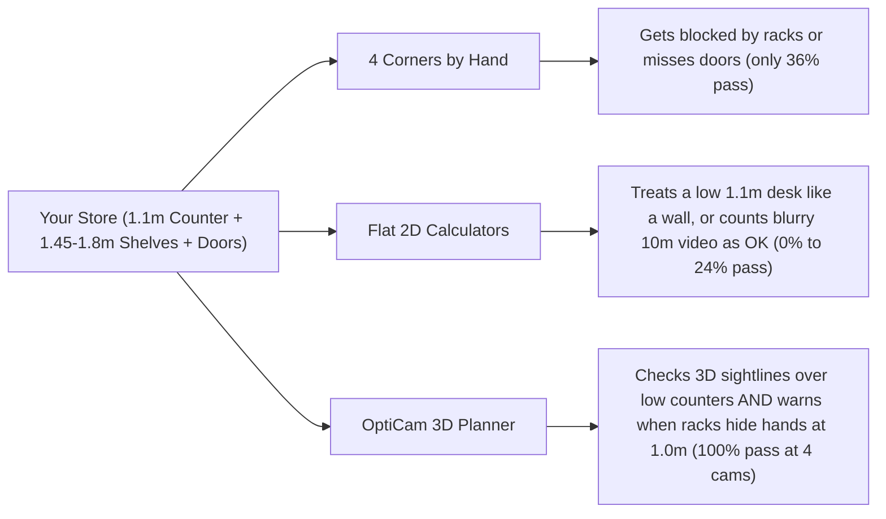

# OptiCam Guide for Store Owners: Better Protection With Fewer Cameras

> **Quick Summary**  
> **OptiCam** turns your shop floor plan into a tested camera plan in **under 0.2 seconds** in the browser (and a few seconds on the Python server). Tested across **7 real store layouts** and **50 unseen test stores**, OptiCam passes strict cashier face-ID and shelf security checks on **`98%` of stores with just 3 cameras** (`49/50`) and **`100%` with 4 cameras** (`50/50`), needing only **`2.48–2.57` cameras on average** for a `50–80 m²` shop.

---

## 1. Why Ordinary Camera Plans Fail in Real Stores

Most quotes either put **4 cameras in the 4 room corners** or use flat 2D tools. Both miss real blind spots in convenience stores (`50–80 m²`):



---

## 2. How OptiCam Works Right Now (`2 Steps`)

You use OptiCam in two simple screens (**`Mặt bằng`** → **`Kết quả`**):

1. **Step 1 (`Mặt bằng` — Set Up Your Store):**
   - Get started quickly with the **6-step interactive spotlight tutorial** (highlights each tool directly on screen, reopenable anytime via `?`), plus a dedicated **3-step guide** inside the layout builder.
   - Pick one of **18 ready-made templates** (3 classic stores + **15 Vietnamese convenience store, mini-mart, cafe, & pharmacy layouts** complete with aisles, coolers, and shoppers), or create your own in **Tạo layout** (**Rectangle, L-shape, Chamfered corner, Trapezoid**, or **point-to-point polygon perimeter drawing**). Use **Xoay 90° (R↔D)** to rotate the room and all placed furniture, cameras, and shoppers together, or **Dựng vách (`W`)** to sketch partition walls anywhere on the floor. *(Every reset/delete action uses a clean in-app confirmation modal—never jarring browser popups.)*
   - Adjust store dimensions with quick footprint presets (`5×12`, `8×8`, `10×6`, `12×8 m`), `−/+` steppers, and a ceiling-height slider/pills (`2.4–6.0 m`), then add doors, checkouts, and **13 store fixture types** (`endcap`, `promo-island`, `checkout-rack`, `locked-cabinet`, `locker`, coolers, gondolas, counters, etc.) with **click-to-place cursor preview** (`R` to rotate, or auto-place), **S / M / L quick sizes**, live sliders, and **stacked shelf-tier folders** choosing from **16 product types (CRAVED theft risk)**—automatically warning if valuable goods sit on low `≤ 1.0 m` shelves.
   - Choose where cameras can go (**Wall + Ceiling**, **Wall only**, or **Ceiling only**), how many cameras you want (`1–20`), and keep **"Chống khuất tầm tay (1.0 m)"** enabled so OptiCam protects both faces (`1.6 m`) and low hands/shelves (`1.0 m`).
2. **Step 2 (`Kết quả` — Check Clarity & Blind Spots):**
   - **Stage 1 (Protect Cash & Doors First):** OptiCam aims the first ~two-thirds of your cameras (`ceil(0.67 × K)`) directly at the register and entrances for sharp Face-ID (`>= 250 PPM`) until Red Zones hit **`95%`**.
   - **Stage 2 (Cover Shelves & Polish Angles):** Remaining cameras sweep merchandise shelves (`>= 125 PPM`) and aisles, then up to **3 quick swap rounds** fine-tune every camera angle with a smart **1.0 m hand-level partial-credit guard** (`>= 62.5 PPM`, targeting `80%`) so cameras watch hands around high-risk racks without getting dragged down behind low counters and spoiling face ID (`17/18` preset stores pass vs only `8/18` under naive strict blocking; `98.7%` hand protection at cashiers/doors and `44%` fewer head-only blind spots).
   - **Hand-Level Blind Spot Check (`1.6 m` vs `1.0 m`):** Every camera view checks **both** face height (`1.6 m`) and hand/product height (`1.0 m`). Floor tiles visible at head level (`1.6 m`) but hidden at hand level (`1.0 m`) are marked with **amber diagonal stripes**, alongside your **1.0 m Hand Coverage (`>= 62.5 PPM`)** metric in the Scorecard.
   - **Auto-Find Minimum Cameras ("Giảm số camera theo KPI"):** Instead of cutting cameras off a bigger plan, OptiCam tests `1`, `2`, `3`, `4` cameras separately from scratch and stops at the **smallest budget** that passes both goals (`2.48` cameras avg vs `4.52` with the old slicer).

---

## 3. Why Were These Exact Numbers Chosen?

Every number in OptiCam comes from international CCTV rules and tests across 57 stores (`7` real + `50` unseen) using standard **4 MP Dome cameras (`2560 px`, `85°` wide lens, `10 m` range)**:

### A. Sharpness Levels: `250 / 125 / 62.5 / 25 PPM` (IEC 62676-4)
Seeing a person walk past is not the same as identifying a face or reading bills at the register:

| Sharpness Level | Pixels Per Meter (PPM) | What You See in Video | Where It Matters & Weight |
|---|---:|---|---|
| **Identification (`Red`)** | `>= 250 PPM` | Clear face details, cash notes | Cashiers & doors (**`1.00`** full credit) |
| **Recognition (`Yellow`)** | `125 – 249 PPM` | Hands reaching, items picked off shelves | Merchandise shelves (**`0.75`** credit) |
| **Observation** | `62.5 – 124 PPM` | Walking direction & clothing | Main aisles (**`0.40`** credit) |
| **Detection** | `25 – 62.4 PPM` | Someone is present in an area | Open floor (**`0.20`** credit; `< 25` = Blind) |

### B. Store Priority Weights: `5 : 3 : 1` (and Shelves `4.5 / 3.0 / 1.8`)
- **Cashier & Doors (`5`)** matter **5×** more than empty walking floor (`1`), while normal shelves sit in the middle (**`3`**), pocket-sized high-theft shelves (cosmetics/blades/batteries) get **`4.5`**, and bulky low-risk goods (water cases/toilet paper) get **`1.8`**.
- **Why not weigh everything equally `(1, 1, 1)`?** Equal weights waste cameras on wide empty floor instead of the cash register: pass rate at 3 cameras collapses from **`98%` down to `4%`** (`40%` at 4 cams).
- **Why whole numbers `5, 3, 1` instead of messy decimals like `6.78, 3.46`?** We tested letting a computer pick exact decimals on 7 real stores and evaluated them on 50 new stores—the messy decimals did **no better** (`97.2%` vs `97.4%` Red Face-ID). Simple `(5, 3, 1)` works just as well everywhere.
- **Why `1.0 m` core & `2.0–2.5 m` fade?** Priority stays at full strength within `1 m` arm's-reach of a till or shelf, then tapers smoothly over `1.0–1.5 m` (`2.5 m` for cash/doors, `2.0 m` for shelves) across queues.

### C. Why Target `95% Red` and `80% Yellow` Instead of `100%`?
Demanding **`100%`** over cashiers sounds safer, until you check the hardware bill across 50 stores:

```text
Red Goal     Uncovered Red Area     Avg Cameras (Old)    What Happens in Real Stores
-----------------------------------------------------------------------------------------------
 85–90%      Up to 1.50–2.00 m²     3.20 – 3.32          Unsafe blind gap right at till / doorway
 94–96%      Only 0.12–0.25 m²      3.58 – 3.84   <--    SWEET SPOT (95% sits right at the bend)
 98–100%     0.00 – 0.06 m²         4.08 – 4.34          24% to 57% of stores MUST buy +1 or +2 EXTRA
                                                         cameras just to hit one tiny corner sliver!
```

- **`95%` Red** leaves at most a tiny `0.175 m²` edge sliver on average (smaller than one `0.5 m × 0.5 m` floor tile) instead of forcing you to buy extra hardware.
- **`80%` Yellow shelves** costs **`0` extra cameras** compared to `70%` (`3.72 -> 3.72`), while ensuring 4 out of 5 shelf zones capture hand-level action clearly.

---

## 4. Real Store Results (`50` Unseen Stores, Identical 4 MP Cameras)

- **3 Cameras (Tight Budget):** OptiCam passes **`98%` (`49/50`)** with **`98.0%` Red Face-ID** (`83 ms` solver), vs. `38%` (old Hybrid), `22%` (wall-only), and `0%–6%` across 4 academic baselines.
- **4 Cameras (Standard Setup):** OptiCam passes **`100%` (`50/50`)** with **`99.6%` Red Face-ID**, vs. `80%` (old Hybrid), `36%` (manual 4-corners), and `0%–24%` across academic baselines.
- **Hardware Needed to Pass Every Store:** **`2.48` cameras** on average (`2.57` on 7 real templates), vs. `4.52` (old prefix slicer), `8.3–10.0` (2D Set Cover), and `22–43` (dense redundant sensor tools).
