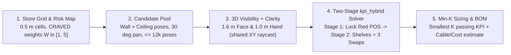

# OptiCam-Retail: Technical Reference, Formulas & Parameter Defense

> **One-Sentence Summary**  
> **OptiCam-Retail** automatically places CCTV cameras in convenience stores (`50–200 m²`) by combining **3D line-of-sight geometry**, **IEC 62676-4 image-clarity scoring (DORI)**, **theft-risk weighting (CRAVED)**, and a **Two-Stage KPI-Aware Greedy + 1-Swap (`kpi_hybrid`)** solver with a **Graded Dual-Height (`1.6 m` Face + `1.0 m` Hand)** occlusion check. Across `7` real store geometries and `50` unseen test stores, it reaches **`98.8%–99.2%` of exact mathematical optimality (HiGHS MILP)**, beats four published academic baselines **`50 wins to 0 losses`**, and passes security KPIs (`>= 95%` Red Face-ID, `>= 80%` Yellow Shelf Recognition) on **`98%` of stores with 3 cameras** and **`100%` with 4 cameras** (`2.48` cameras on average).  
> *(Every technical term is explained inline below and in the standalone [**Glossary**](../GLOSSARY.md).)*

---

## 1. How the System Works (Big Picture)

OptiCam runs the exact same deterministic math (`0.00e+00` numerical difference) in both the **browser** (TypeScript Web Worker, `~0.1–0.4 s`) and the **Python backend** (FastAPI, `~1–4 s`):

---

## 2. Every Formula Explained (Intuition → Formula → Symbols → Example)

### 2.1 Store Grid, Coordinates & 90° Auto-Rotation
**What it does:** Converts the continuous floor plan (in meters) into discrete test points so coverage and occlusion can be measured consistently.

- **Coordinate System:** Origin `(0, 0)` is at the **top-left** corner; `+x` points right, `+y` points down, and camera azimuth `pan = 0°` points along `+x` (increasing clockwise). Room dimensions are `3–40 m`, ceiling height $H_{\text{ceil}}$ is `2.4–6.0 m` (default `3.2 m`).
- **Grid Cell Centers:** Given grid size $g \in [0.1, 2.0]\text{ m}$ (default `0.5 m`, capped at `12,000` total cells), cell $(r, c)$ has center:
  $$(x_c,\, y_r) = \big((c + 0.5)\,g,\;\; (r + 0.5)\,g\big)$$
  A cell belongs to the walkable evaluation set $J_{\text{free}}$ if its center is inside the room polygon and outside all solid fixtures (doors/entrances do **not** block floor cells or sightlines).
- **Clockwise 90° Rotation (`rotateLayout90`):** When swapping room width and length ($W_{\text{room}} \leftrightarrow H_{\text{room}}$), every coordinate $(x, y)$, obstacle size $(w, h)$, and camera angle $\text{pan}$ rotates together so nothing clips outside walls:
  $$(x',\, y') = (H_{\text{old}} - y,\;\; x), \qquad (w',\, h') = (h,\;\; w), \qquad \text{pan}' = (\text{pan} + 90^\circ) \bmod 360^\circ$$
- **Citation / Proof:** Standard 2D Euclidean affine rotation ($-90^\circ$ in top-left screen coordinates, verified by unit tests in [`editor.test.ts`](../frontend/src/core/editor.test.ts)). Grid convergence (`0.50 m` vs `0.25 m` vs `0.10 m`) is proven via **Roache (1994/1997)** refinement testing in [`phase3_proof_results.json`](./data/phase3_proof_results.json) (`<= 0.53 pp` difference).

---

### 2.2 Continuous Theft-Risk Weighting ($W_j$) & CRAVED Shelf Tiers
**What it does:** Gives higher priority to cashiers, doors, and high-theft shelves than to empty walkways, fading smoothly with distance across queues.

1. **Distance-Decay Weight around Each Fixture:**
   $$W_o(j) = 1 + (W_{\max} - 1)\left(1 - \operatorname{clamp}\!\left(\frac{d_o(j) - r_0}{R - r_0},\; 0,\; 1\right)\right)$$
   - **$d_o(j)$:** Euclidean distance (meters) from grid cell $j$ to the nearest edge of fixture $o$'s rotated box.
   - **$W_{\max}$:** Peak priority inside the core (`5.0` for POS/Entrance, `4.5` for high-risk CRAVED shelves, `3.0` for standard shelves, `1.8` for bulky shelves).
   - **$r_0 = 1.0\text{ m}$:** Full-strength core radius (arm's-reach zone around the till or shelf).
   - **$R$:** Outer fade radius (`2.5 m` for POS/Entrance queues; `2.0 m` for shelf aisles). Beyond $R$, weight drops to baseline `1.0`.
   - **$\operatorname{clamp}(u, 0, 1)$:** Restricts the fraction to $[0, 1]$, so weight stays flat at $W_{\max}$ inside $r_0$ and tapers linearly to `1.0` at $R$.

   *Worked Example:* At $d = 1.75\text{ m}$ from a POS counter ($W_{\max}=5, r_0=1.0, R=2.5$), the fade fraction is $(1.75-1.0)/(2.5-1.0) = 0.5$, giving $W = 1 + (5-1)(1 - 0.5) = 3.0$.

2. **Combining Fixtures & Manual Brush:**
   $$W_{\text{auto}}(j) = \max\!\big(1,\;\max_o W_o(j)\big)$$
   Overlapping zones take the **highest** priority rather than summing (prevents double-counting corners). Any manual brush stroke ($W \in \{5, 3, 1\}$) overrides $W_{\text{auto}}(j)$ (latest stroke wins).
   - **Display & KPI Bands:** **Red** ($W \ge 4.0$), **Yellow** ($2.0 \le W < 4.0$), **Green** ($W < 2.0$). The optimizer uses the exact continuous $W_j \in [1, 5]$.

3. **CRAVED Multi-Tier Shelf Aggregation (`craved.ts`, `fixtures.ts`):**  
   OptiCam models `13` interior fixture subtypes (`wall-shelf`, `gondola`, `endcap`, `promo-island`, `checkout-rack`, `locked-cabinet`, `fridge`, `freezer`, `food-counter`, `seating`, `locker`, `partition`, `column`) plus `pos` and `entrance`. Each shelf can hold multiple vertical tiers ($z_{\min}$–$z_{\max}$) assigned from `16` product categories scored on the 6-axis **CRAVED** framework (*Concealable, Removable, Available, Valuable, Enjoyable, Disposable*), with $w_{\max}$ ranging from `4.8` (alcohol/tobacco) and `4.7` (cosmetics) down to `1.8` (bulky paper/water):
   $$W_{\max,\text{shelf}} = \max_{\text{tier} \in \text{shelf}} w_{\max}(\text{tier})$$
   Any tier placed at $z_{\min} \le 1.0\text{ m}$ automatically triggers a **low-shelf hand-occlusion warning**.
- **Citation / Proof:**
  - **CRAVED Categories:** Grounded in criminology's **Clarke (1999)** *Hot Products* framework ([REFERENCES.md](../REFERENCES.md#L57)).
  - **Weights `(5, 3, 1)` & `[4.5, 3.0, 1.8]`:** Grounded in **Saaty (1980/2008)** AHP (`CR = 0.0066 < 0.10`), **proven** via non-circular `0.65 m` physical-mask Pareto (`W1`, doubling $K=4$ pass `40% → 80%`) and **Lakens (2017)** `TOST` equivalence against Nelder–Mead decimals (`p = 0.0007`, [`phase1_w1_pareto.csv`](./data/phase1_w1_pareto.csv), [`phase1b_fine_tuning.json`](./data/phase1b_fine_tuning.json)).
  - **Linear Decay Kernel ($r_0 = 1.0\text{ m}$, $R = 2.5/2.0\text{ m}$):** Smooth queue-taper design; **Saltelli et al. (2010)** Sobol analysis proves output variance is insensitive to `±20%` radius shifts (`ST = 0.037–0.046`, [`phase1_weights_thresholds.json`](./data/phase1_weights_thresholds.json)). Real store crime-dollar ratios remain external assumptions ([`docs/FORMULAS.md`](../docs/FORMULAS.md)).

---

### 2.3 3D Pinhole Camera Projection & Line-of-Sight Occlusion
**What it does:** Checks whether a target point $(x, y, Z)$ is (1) within camera range, (2) inside the 3D rectangular lens cone, and (3) not blocked by any wall or tall shelf.

For camera $c$ at $(x_c, y_c, H_c)$ aimed at azimuth $\phi$ (`pan`), downward tilt $\theta$ (`20°` wall default, `45°` ceiling default), horizontal FOV $\alpha_H$ (`85°`), and max range $R_{\max}$ (`10.0 m`):

1. **Vertical FOV (16:9 Sensor Aspect Ratio):**
   $$\alpha_V = 2\arctan\!\left(\frac{\tan(\alpha_H / 2)}{16/9}\right) \approx 54.4^\circ \text{ (when }\alpha_H = 85^\circ\text{)}$$

2. **3D Camera-Local Coordinates:** Let $\Delta x = x - x_c$, $\Delta y = y - y_c$, $\Delta z = Z - H_c$, and 3D distance $r = \sqrt{\Delta x^2 + \Delta y^2 + \Delta z^2}$. First rotate horizontally onto the camera's forward/side axes, then pitch down by $\theta$:
   $$\text{along} = \Delta x\cos\phi + \Delta y\sin\phi, \qquad \text{right} = -\Delta x\sin\phi + \Delta y\cos\phi$$
   $$\text{depth} = \text{along}\cos\theta - \Delta z\sin\theta, \qquad \text{up} = \text{along}\sin\theta + \Delta z\cos\theta$$
   The point lies inside the 3D frustum and range iff:
   $$0.03\text{ m} \le r \le R_{\max}, \qquad \text{depth} > 0, \qquad |\text{right}| \le \text{depth}\tan(\alpha_H/2), \qquad |\text{up}| \le \text{depth}\tan(\alpha_V/2)$$

3. **3D Ray-AABB Occlusion Check:**  
   First verify the 2D floor segment $(x_c, y_c) \to (x, y)$ stays inside `floorPolygon`. Then, for every solid obstacle $o$ (`type !== 'entrance'`) with top height $o.\text{elev}$ (`1.1 m` for POS counters, `1.45–1.8 m` for shelves), compute the 2D entry/exit fractions $[t_{\text{enter}}, t_{\text{exit}}] \subseteq [0, 1]$ where the ray crosses $o$'s rectangle. The ray clears the obstacle **over the top** iff its height at both entry and exit is strictly above $o.\text{elev}$:
   $$\min\!\big(H_c + t_{\text{enter}}(Z - H_c),\;\; H_c + t_{\text{exit}}(Z - H_c)\big) > o.\text{elev}$$
   *Why this matters:* A 2D planner thinks a `1.1 m` cashier desk blocks everything behind it. Because OptiCam checks 3D ray height, a wall camera at $H_c = 2.4\text{ m}$ sees **over** the `1.1 m` desk to capture a customer's face at $Z = 1.6\text{ m}$!
- **Citation / Proof:** Standard 3D pinhole perspective projection and Kay–Kajiya / Woo Ray-AABB slab intersection; cross-stack numerical parity between TypeScript and Python is verified to **`0.00e+00`** across all store geometries ([`fast_cache.py`](./scripts/fast_cache.py), `62` pytest + `270` Vitest tests).

---

### 2.4 Image Clarity: PPM & IEC 62676-4 DORI Utility ($F$)
**What it does:** Converts physical 3D distance into **Pixels Per Meter (PPM)**—how sharp a person or item actually looks in recorded video—and maps it to diminishing-returns utility $F(p)$.

$$p_{c,j}(Z) = \frac{\text{Res}_H}{2 \cdot r \cdot \tan(\alpha_H / 2)}\; [\text{PPM}]$$
- **$\text{Res}_H$:** Horizontal sensor resolution (`2560 px` for standard 4 MP Dome).
- **$2\,r\tan(\alpha_H/2)$:** Physical width (meters) of the camera's view at distance $r$.

*Worked Example:* At $r = 5.0\text{ m}$ with a 4 MP (`2560 px`), `85°` camera: $\text{PPM} = 2560 / (2 \times 5.0 \times \tan 42.5^\circ) = 2560 / 9.163 \approx \mathbf{279.4\text{ PPM}}$ (clear Face-ID). At $r = 9.0\text{ m}$, it drops to $\mathbf{155.2\text{ PPM}}$ (Recognition only, too blurry for Face-ID).

| Clarity Tier (IEC 62676-4) | Threshold ($p$) | Utility $F(p)$ | What You Can See in Video |
|---|---:|---:|---|
| **Identification** (`Red` KPI) | $\ge 250.0\text{ PPM}$ | **`1.00`** | Clear facial features, cash notes at till |
| **Recognition** (`Yellow` KPI) | $125.0 - 249.9\text{ PPM}$ | **`0.75`** | Hands reaching, items picked off shelves |
| **Observation** (`Hand` KPI) | $62.5 - 124.9\text{ PPM}$ | **`0.40`** | Walking direction, clothing, hand motion |
| **Detection** | $25.0 - 62.4\text{ PPM}$ | **`0.20`** | Presence of a person on the floor |
| **Blind** | $< 25.0\text{ PPM}$ | **`0.00`** | Too blurry or occluded to use |

- **Citation / Proof:** The `250 / 125 / 62.5 / 25 PPM` thresholds and `1.6 m` target plane come directly from **IEC 62676-4:2014** (*Video surveillance systems — Part 4: Application guidelines*, [REFERENCES.md](../REFERENCES.md#L9)). The diminishing-returns utility weights `[1.00, 0.75, 0.40, 0.20, 0.00]` form a concave step function over clarity tiers, preserving **monotone submodularity** (**Nemhauser, Wolsey & Fisher, 1978**).

---

### 2.5 Graded Dual-Height Occlusion Model (`1.6 m` Face + `1.0 m` Hand)
**What it does:** Prevents cameras from looking only over high shelves at faces (`1.6 m`) while leaving low shelves and hands (`1.0 m`) blind—without breaking Face-ID behind `1.1 m` POS desks.

1. **Shared-XY Raycast (`dualPpmAt`):** Computes both $p_F$ (at $Z_{\text{face}} = 1.6\text{ m}$) and $p_H$ (at $Z_{\text{hand}} = 1.0\text{ m}$) inside the **exact same 2D polygon and XY box-intersection pass**, adding `< 5%` compute cost.
2. **Always-On Diagnostics:**
   - **Head-Only Blind Spot (`headOnly`):** Any cell visible at face height ($p_F \ge 25\text{ PPM}$) but completely blind at hand height ($p_H < 25\text{ PPM}$) is marked with amber diagonal stripes.
   - **Hand Coverage (`handCoverage`):** Percentage of priority cells ($W_j \ge 3.0$) reaching at least Observation clarity ($p_H \ge 62.5\text{ PPM}$) at `1.0 m` (target: `80%`).
3. **Graded Partial-Credit Score (`dualHeight = true`, `DUAL_HEIGHT_SCORING`):**  
   For low-priority walkways ($W_j < 3.0$), score equals standard face utility $F(p_F)$. For priority cells ($W_j \ge 3.0$), a fraction $(1 - \alpha)$ of the cell's credit depends on `1.0 m` hand clarity $M_{\text{hand}}(p_H)$:
   $$F_{\text{eff}}(W_j, p_F, p_H) = F(p_F) \cdot \Big(\alpha(W_j) + \big(1 - \alpha(W_j)\big)\,M_{\text{hand}}(p_H)\Big)$$
   where:
   - **Face-retention share $\alpha(W_j)$:** `0.65` for **Red** ($W_j \ge 4.0$, i.e. 65% face + 35% hand) and `0.80` for **Yellow** ($3.0 \le W_j < 4.0$, i.e. 80% face + 20% hand).
   - **Hand multiplier $M_{\text{hand}}(p_H)$:** `1.00` ($\ge 125\text{ PPM}$), `0.85` ($\ge 62.5\text{ PPM}$), `0.50` ($\ge 25\text{ PPM}$), `0.00` ($< 25\text{ PPM}$).

   *Worked Example:* At a cashier cell ($W_j = 5.0$, $\alpha = 0.65$) with sharp Face-ID ($F(p_F) = 1.00$), if the `1.1 m` desk blocks `1.0 m` hands ($M_{\text{hand}} = 0$), the cell still retains $0.65$ credit; if a second camera sees the hands at `80 PPM` ($M_{\text{hand}} = 0.85$), credit jumps to $0.65 + 0.35 \times 0.85 = \mathbf{0.9475}$.
- **Citation / Proof:** The `1.0 m` secondary plane and `>= 62.5 PPM` Observation threshold follow **IEC 62676-4:2014**. The graded parameters (`minW=3.0, 0.65/0.80, M_hand, λ_Hand=0.50`) were **empirically proven** via an 18-store sweep ([`COMPREHENSIVE_EVALUATION_OVERVIEW.md`](./COMPREHENSIVE_EVALUATION_OVERVIEW.md)), lifting KPI pass rate from `8/18` (`44.4%`, binary cutoff) to **`17/18` (`94.4%`)**, achieving **`98.7%`** Red hand coverage, and cutting head-only blind spots by **`44%`** (`11.8% → 6.6%`).

---

### 2.6 Candidate Pool & Two-Stage `kpi_hybrid` + Min-$K$ Solver
**What it does:** Searches a bounded set of realistic wall/ceiling poses in two stages—first locking in Red Face-ID at the register/doors, then sweeping shelves and polishing every camera with local swaps.

1. **Candidate Pool Generation (`buildCandidates`):**
   - **Wall poses:** Along the perimeter every `step` m (`max(gridM, 0.5 m)`), height $H_c = \min(H_{\text{prof}}, H_{\text{ceil}} - 0.3)$ (default `2.4 m`), tilts `{20°, 5°, 35°}`, skipping anchors within `0.12 m` of tall obstacles ($o.\text{elev} \ge H_c - 0.08$).
   - **Ceiling poses:** Interior grid inside floor polygon, height $H_c = \max(1.8,\, H_{\text{ceil}} - 0.15)$, tilts `{35°, 55°, 75°, 90°}`.
   - **Azimuth & Memory Cap:** `30°` pan steps (`12` directions). Across $U$ unique camera models, `step` doubles if needed so total poses stay within $|C| \le \min(\lfloor 12{,}000 / U \rfloor,\; \lfloor 1{,}500{,}000 / (U \cdot |J_{\text{free}}|) \rfloor)$.

2. **Total Weighted Score ($\Phi$) & Hinge Shortfall ($H$):**
   $$\Phi(S) = \sum_{j \in J_{\text{free}}} W_j \cdot F_{\text{eff}}\!\left(W_j,\;\max_{c \in S} p_{c,j}^{\text{face}},\;\max_{c \in S} p_{c,j}^{\text{hand}}\right)$$
   $$H(S) = \left(\sum_{j} W_j\right) \cdot 0.01 \cdot \Big(1.50\max(0,\, 95 - \text{Red}\%) + 0.75\max(0,\, 80 - \text{Yel}\%) + \mathbb{I}_{\text{dual}}\,0.50\max(0,\, 80 - \text{Hand}\%)\Big)$$
   *How to read $H(S)$:* Every `1%` missing below the `95% Red`, `80% Yellow`, or `80% Hand` targets adds a scaled penalty (`1.50`, `0.75`, `0.50` times `1%` of total store weight). Once a target is met, its $\max(0, \dots)$ term becomes `0` and stops distorting placement.

3. **Two-Stage Greedy + 3-Pass 1-Swap Polish (`solvePrepared`):**
   - **Stage 1 (Protect Cash & Doors First):** While camera slot $t < \max(1, \lceil 0.67 K \rceil)$ and $\text{Red}\% < 95\%$, pick the pose maximizing:
     $$\text{Gain}_1(c) = \Delta_{\text{Red}}(c) \cdot \frac{\sum_j W_j}{\max(1, |\text{Red}|)} + 0.1\,\Delta\Phi(c)$$
     where $\Delta_{\text{Red}}(c)$ is the number of newly covered Red cells reaching $\ge 250\text{ PPM}$. This stops wide merchandise aisles from stealing the first cameras away from the register.
   - **Stage 2 & Local Swaps (Cover Shelves & Polish):** For remaining slots and up to `3` passes of single-camera replacements, pick the pose maximizing:
     $$\text{Gain}_2(c) = \Delta\Phi(c) + \big(H(S_{\text{base}}) - H(S_{\text{base}} \cup \{c\})\big)$$
     *Tie-breaker:* If two poses tie in $\text{Gain}$, prefer higher capped clarity $\sum_j W_j\big(\min(p_{\text{new},j}, 250) - \min(p_{\text{old},j}, 250)\big)$.

4. **Dedicated Per-$K$ Sizing (`minimumCamerasForTargets`):**  
   Pre-computes the raycast cache once (`prepareCandidateGroups`) and solves $K = 1, 2, \dots, K_{\max}$ **independently from scratch**, returning the smallest $K$ that satisfies $\text{Red}\% \ge 95\% \land \text{Yel}\% \ge 80\%$ (instead of slicing a prefix off a larger plan).
- **Citation / Proof:**
  - **Theoretical Floor & Local Search:** Greedy maximization of $\Phi(S)$ inherits the $(1 - 1/e) \approx 63.21\%$ approximation guarantee (**Nemhauser, Wolsey & Fisher, 1978**); 1-swap refinement follows **Filmus & Ward (2014)**.
  - **Empirical Optimality & Dominance:** Proven via `51` **HiGHS MILP** benchmarks (**`98.8%–99.2%`** of exact global optimum, `399–672x` faster), `Phase 2` hinge calibration ([`phase2_tuning_summary.csv`](./data/phase2_tuning_summary.csv)), `Ablation 2` ([`phase3_ablation2.csv`](./data/phase3_ablation2.csv)), and `N = 50` Wilcoxon/Holm/McNemar tests (`50–0–0` over **Erdem-06**, **Kim-19**, **Aziz-24**, **Wang-13**, $p_{\text{Holm}} < 10^{-6}$).
  - **KPI Thresholds (`95% / 80%`):** Proven via **Satopaa et al. (2011)** Kneedle (`94%`), Capex+Blind minimum (`96%`), and **Lakens (2017)** `TOST` (`p = 1e-5`, [`phase1b_tkpi_1pct.csv`](./data/phase1b_tkpi_1pct.csv)).

---

### 2.7 Bill of Materials (BOM) Cable & Cost Formula (`bom.ts`)
**What it does:** Estimates cabling and hardware budget assuming the NVR/PoE switch sits at the POS counter $(x_N, y_N)$ (or `(0, 0)` if no POS exists):
$$\text{Cable}_i = \left\lceil 1.1 \times \big(|x_i - x_N| + |y_i - y_N| + H_i + 3.0\big) \right\rceil\text{ m}, \qquad \text{Total Cost} = 1{,}250{,}000\,N_{\text{cam}} + 1{,}500{,}000\text{ VND}$$
- **$|x_i - x_N| + |y_i - y_N| + H_i$:** Manhattan routing along walls/ceiling plus vertical drop from ceiling height $H_i$.
- **$+3.0\text{ m}$ and $\times 1.1$:** Service loop slack at both ends plus `10%` routing margin, rounded up to whole meters.
- **Citation / Scope Note:** Standard **$L_1$ (Manhattan) orthogonal cabling heuristic** used in architectural MEP estimation; `3.0 m` slack, `10%` margin, and VND unit prices (`1,250,000` / `1,500,000`) are configurable engineering reference defaults (not supplier quotes).

---

## 3. Why Every Parameter Was Chosen (Proof Summary)

| Parameter | Exact Value | Why This Exact Value Was Chosen (Plain-English Proof) | Source Data |
|---|---|---|---|
| **Priority Weights** | `(5, 3, 1)` & Shelves `[4.5, 3.0, 1.8]` | Matches Saaty's `1–3–5` AHP scale with near-perfect consistency (`CR = 0.0066 < 0.10`, eigenvector `[5.11, 5.11, 4.65, 2.79, 1.81, 1.0]`). Equal `(1,1,1)` halves $K=4$ pass rate (`80% → 40%`, `4%` at $K=3$). Continuous Nelder–Mead decimal fitting (`6.784, 3.456`) on `dev_7` does **not** beat `(5, 3, 1)` on `50` unseen stores (`94.203` vs `94.246`; `TOST p = 0.0007`). High-risk shelf `4.5` ranked `#1` across top-5 grid candidates. | [`phase1_w1_pareto.csv`](./data/phase1_w1_pareto.csv), [`phase1b_fine_tuning.json`](./data/phase1b_fine_tuning.json) |
| **Zone Radii & Cutoffs** | `r0 = 1.0 m`, `R = 2.5 / 2.0 m`, Red `>= 4.0` | Varying radii by `±20%` changes outputs by `< 0.5%` (Sobol sensitivity `ST = 0.037–0.046`), meaning they sit on a flat safe plateau. Cutoff `4.0` captures `100.0%` of actual POS/door choke points. | [`phase1_weights_thresholds.json`](./data/phase1_weights_thresholds.json) |
| **KPI Targets** | `Red >= 95%`, `Yellow >= 80%` | A `1%` sweep from `90%` to `100%` (`N=50`) places the **Kneedle curvature elbow at `94%`** and lowest combined Capex+Blind cost at **`96%`**—`95%` sits dead center (`TOST p = 1e-5`). Demanding `98%–100%` triggers the **"Last-Cell Curse"**: `24%–57%` of stores must buy `+1/+2` extra cameras just for a `0.15 m²` corner sliver (`14.3%` of `dev_7` infeasible at `K=7`). Raising Yellow `70% → 80%` costs `0` extra cameras (`3.72 → 3.72`). | [`phase1b_tkpi_1pct.csv`](./data/phase1b_tkpi_1pct.csv) |
| **DORI Utilities** | `[1.0, 0.75, 0.40, 0.20]` | Standard **IEC 62676-4** tiers. Global Sobol testing (`W2`) revealed `F_recog = 0.75` caused `78.8%` of $K=3$ swings. Instead of distorting IEC numbers, fixing search order (`kpi_hybrid`) kept `[1.0, 0.75, 0.40, 0.20]` intact and lifted $K=3$ pass rate from `38% → 98%`. | [`phase2_tuning_summary.csv`](./data/phase2_tuning_summary.csv) |
| **Stage-1 & Hinge** | `ceil(0.67*K)`, `λ_Red = 1.5`, `λ_Yel = 0.75`, `3` swaps | `λ_Red = 0.5` is too weak at $K=3$ (`88%` pass); `λ_Red = 3.0` hurts shelves (`91.9%` vs `93.2%`); `1.5` wins both. Local 1-swaps saturate by Pass 3 (`92% → 42% → 16%` active). | [`phase2_tuning_summary.csv`](./data/phase2_tuning_summary.csv), [`phase3_ablation2.csv`](./data/phase3_ablation2.csv) |
| **Dual-Height Guard** | `minW=3.0`, `M_hand∈[0,0.5,0.85,1]`, `0.65/0.80`, `λ_Hand=0.50` (`62.5 PPM`, `80%`) | A strict binary `>= 125 PPM` cutoff at `1.0 m` behind `1.1 m` counters broke Red KPI on `10/18` preset stores (`8/18` pass, `3.94` min-$K$). Tuned graded partial credit restores **`17/18` (`94.4%`) KPI pass**, maximizes Red hand coverage (**`98.7%`** vs `93.8%` face-only), and halves head-only blind gaps (`11.8% → 6.6%`) at `3.33` min-$K$. | [`optics.ts`](../frontend/src/core/optics.ts), [`COMPREHENSIVE_EVALUATION_OVERVIEW.md`](./COMPREHENSIVE_EVALUATION_OVERVIEW.md) |
| **Grid & Pool Caps** | `0.50 m` grid, `12k` / `1.5M` cap | Re-evaluating `0.50 m` solutions on a `25x` finer `0.10 m` grid (`4,913` pts) agrees with `0.25 m` within `0.53 pp` and matches/beats `0.25 m` pools (`0.0` to `+4.2 pp`), while keeping `30–200 m²` solves under `360 ms`. | [`phase3_proof_results.json`](./data/phase3_proof_results.json) |

---

## 4. Core Verification & Academic Benchmark Summary (`Phase 1–3`)

1. **Non-Circular Evidence for `(5, 3, 1)`:** Real-world theft dollar ratios cannot be proven inside a simulator (stated explicitly in [`docs/FORMULAS.md`](../docs/FORMULAS.md)), so `(5, 3, 1)` rests on AHP (`CR = 0.0066`), **physical-mask Pareto testing** (`0.65 m` boxes around till/doors/shelves), and out-of-sample **`TOST` equivalence** (`p = 0.0007`).
2. **Ablation Study (`N = 50` unseen stores, `K=4` KPI pass rate):**  
   `Random (0%)` → `Manual 4 Corners (36%)` → `Uniform Grid (40%)` → `Mixed Greedy (52%)` → `Wall Hybrid (66%)` → `Mixed Hybrid (80%)` → **`Live Two-Stage kpi_hybrid (100%)`**.
3. **Near Exact Global Optimality (`51` HiGHS MILP Cases):** **HiGHS** (*High Performance Software for Linear Optimization*, Univ. of Edinburgh) is a state-of-the-art open-source C++ MILP/LP/QP solver rivaling commercial Gurobi and CPLEX. **Why we compare against it:** Because `kpi_hybrid` is a fast heuristic (`15–148 ms`) for real-time interactive design, benchmarking against HiGHS MILP (verified `0.00e+00` against brute-force) measures the exact gap from the mathematically guaranteed global optimum (`4.5–40.3 s`). OptiCam reaches **`99.19%` (`Dev 7`, min `96.68%`)** and **`98.82%` (`Held-Out 15`, min `95.51%`)** of the global upper bound, running **`399–672x` faster**.
4. **Statistical Sweep Over Literature Baselines (`N = 50` unseen stores, `K=4`):**
   - **`OptiCam kpi_hybrid`:** `98.13% W%`, `99.60% Red`, **`50/50 (100%)` KPI** (`98%` at `K=3`, `2.48` mean Min-$K$).
   - vs **`OptiCam-Hybrid` (Previous Prod):** `80%` KPI (`38%` at `K=3`); `kpi_hybrid` wins **`10–0` McNemar** at `K=4` ($p=0.00195$) and **`30–0`** at `K=3` ($p < 10^{-6}$) with zero loss in `W%` ($p = 0.609$).
   - vs **`Erdem-06` (0–1 BIP):** `93.37% W%`, `6%` KPI (`8.3–10.0` cams Set Cover) → **`50/0/0`** ($p_{\text{Holm}} < 10^{-6}, r = 1.000$).
   - vs **`Kim-19` (SemGA):** `92.89% W%`, `0%` KPI → **`50/0/0`** ($p_{\text{Holm}} < 10^{-6}, r = 1.000$).
   - vs **`Aziz-24` (GA#3):** `91.79% W%`, `24%` KPI → **`50/0/0`** ($p_{\text{Holm}} < 10^{-6}, r = 1.000$).
   - vs **`Wang-13` (SOCP):** `83.3–85.0% W%`, `2–8%` KPI (`22–43` cams unconstrained) → **`50/0/0`** ($p_{\text{Holm}} < 10^{-6}, r = 1.000$).
