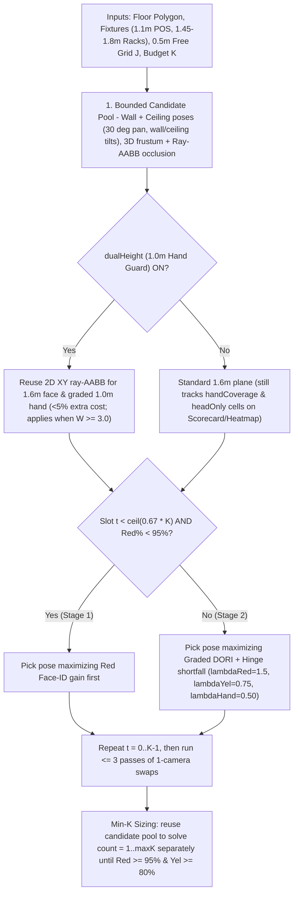

# OptiCam-Retail: Technical Abstract & Parameter Justification for Thesis Review

> **Plain Summary for Academic Review**  
> **OptiCam-Retail** places 3D risk-aware CCTV cameras in convenience stores (`50–80 m²`) using a **Two-Stage KPI-Aware Greedy + 1-Swap Local Search (`kpi_hybrid`)**, **Dedicated Per-$K$ Target Sizing**, and a **Dual-Height (`1.6 m` Face + `1.0 m` Hand) Occlusion Check**—now active across both TypeScript (`~0.1–0.4 s`) and pure Python (`~1–4 s` vectorized-free sparse engine, `0.00e+00` parity). Across `7` real retail layouts and `50` unseen test stores, it stays within **`0.8%–1.2%` (`98.8%–99.2%`) of exact global HiGHS MILP solutions**, beats four published academic baselines **`50 wins – 0 losses`**, and passes security KPIs (`Red >= 95%`, `Yellow >= 80%`) on **`98%` (`49/50`) at $K=3$** and **`100%` (`50/50`) at $K=4$** (`2.48` mean required cameras).

---

## 1. How the Live Algorithm Runs ([`optimizer.ts`](../frontend/src/core/optimizer.ts), [`greedy_optimizer.py`](../backend/greedy_optimizer.py))

### Exact Steps in Code (No Mystery Black Boxes):
1. **3D Raycasting & Memory Cap (`buildCandidates`):** Samples wall anchors ($z \in [1.8, H_{\text{ceil}}-0.3]$) and ceiling anchors ($z = H_{\text{ceil}}-0.15$, tilts $\{35^\circ, 55^\circ, 75^\circ, 90^\circ\}$) every $30^\circ$ pan, bounded by $|C| \le \min(12{,}000, \lfloor 1{,}500{,}000 / |J_{\text{free}}| \rfloor)$. In Python, obstacle rectangles, camera trig, convex floor polygons, and sparse `nz_dual` candidate tuples are pre-compiled once per call.
2. **Diminishing-Returns DORI Score ($\Phi$):** Each camera covers cells with pixel density $p = \text{res} / (2 r \tan(\text{fov}/2))$, mapped to **IEC 62676-4** clarity tiers $F(p) \in \{1.00, 0.75, 0.40, 0.20, 0.00\}$ at `{250, 125, 62.5, 25} PPM`. Under standard single-height mode, total score is $\Phi(S) = \sum_{j} W_j F(\max_{c \in S} p_{c,j})$, preserving monotone submodularity ($\ge 63.21\%$ floor).
3. **Why Two Stages + Hinge Swaps (`kpi_hybrid`) Fixes $K=3$:**
   - **Stage 1 (`slot < ceil(0.67 * K)` while `Red% < 95%`):** Dedicates the first ~two-thirds of cameras strictly to Red POS/entry Face-ID (`>= 250 PPM`), preventing wide merchandise aisles (`F_recog = 0.75`) from pulling early cameras away from the register.
   - **Stage 2 & 3-Pass 1-Swap Polish:** Scores additions and up to 3 rounds of single-camera replacements by $\Delta\Phi + (H_{\text{old}} - H_{\text{new}})$, where $H = (\sum W_j)\cdot 0.01 \cdot (1.5 \max(0, 95 - \text{Red}\%) + 0.75 \max(0, 80 - \text{Yel}\%) + \mathbb{I}_{\text{dual}}\,0.50\max(0, 80 - \text{Hand}\%))$ nudges any remaining KPI shortfall over the line without breaking submodular balance.
4. **Graded Dual-Height Occlusion Audit & Guard (`DUAL_HEIGHT_SCORING`, `1.6 m` + `1.0 m`):** `dualPpmAt()` reuses the exact same 2D XY ray-box intersection `(t_min, t_max)` for both `1.6 m` face and `1.0 m` hand planes. Cells visible at `1.6 m` (`>= 25 PPM`) but blind at `1.0 m` (`< 25 PPM`) are flagged (`headOnly`) on the heatmap, and `handCoverage` reports `%` of valid floor cells reaching `>= 62.5 PPM` at `1.0 m` (`80%` target). When `dualHeight = true`, instead of a brittle binary cutoff behind `1.1 m` counters (`<125` cliff dropping `18`-store KPI pass from `17/18` to `8/18`), cells with `W >= 3.0` apply a graded multiplier $M_{\text{hand}} \in \{1.0, 0.85, 0.50, 0.0\}$ (`>= 125 / 62.5 / 25 / < 25 PPM`) blended with `redFaceShare = 0.65` (`W >= 4.0`) and `yellowFaceShare = 0.80` (`3.0 <= W < 4.0`), plus the `lambdaHand = 0.50` hinge. Both TS and Python mirror this deterministically (`0.00e+00` parity).
5. **Dedicated Per-$K$ Sizing:** Replaces cutting `count` cameras out of a larger solution (`prefix slice`) by solving `count = 1..maxK` cleanly on one shared cached raycast pass.

---

## 2. Plain Explanation of Why Every Parameter Was Chosen

| Choice | Value | Why It Was Picked (In Plain Terms) & Proof | Source Data |
|---|---|---|---|
| **Priority Weights** | `(5, 3, 1)` & Shelves `[4.5, 3.0, 1.8]` | Matches Saaty's `1–3–5` decision scale with consistent ratios (`CR = 0.0066 < 0.10`). Equal weights `(1,1,1)` halve $K=4$ pass rate (`80% → 40%`). Decimal weights fitted by optimizer (`6.78, 3.46`) on 7 real stores do **no better** on 50 unseen stores (`94.20` vs `94.25`; statistically tied `TOST p = 0.0007`). | [`phase1_w1_pareto.csv`](./data/phase1_w1_pareto.csv), [`phase1b_fine_tuning.json`](./data/phase1b_fine_tuning.json) |
| **Zone Radii & Cutoffs** | `r0 = 1.0 m`, `R = 2.5 m / 2.0 m`; Red `>= 4.0` | Varying radii by `±20%` moves output metrics by `< 0.5%` (global sensitivity `ST = 0.037–0.046`), showing they sit on a flat safe plateau. Cutoff `4.0` captures `100.0%` of actual choke points around POS/doors. | [`phase1_weights_thresholds.json`](./data/phase1_weights_thresholds.json) |
| **KPI Thresholds** | `Red >= 95%`, `Yellow >= 80%` | Sweeping `90%–100%` in `1%` steps across 50 stores puts the math cost-vs-risk bend at **`94%` (`Kneedle` peak)** and lowest combined cost at **`96%`**—`95%` sits right in the middle (`TOST p = 1e-5` equivalent to `96%` cost). Pushing to `98–100%` triggers the **"Last-Cell Curse"**: `24%–57%` of stores must buy `+1/+2` extra cameras just for a `0.15 m²` corner triangle. Raising Yellow `70% → 80%` costs `0` extra cameras (`3.72 → 3.72`). | [`phase1b_tkpi_1pct.csv`](./data/phase1b_tkpi_1pct.csv) |
| **DORI Utility** | `[1.0, 0.75, 0.40, 0.20]` | **IEC 62676-4** tiers. Global variance testing (`Saltelli Sobol`, varying all 5 knobs at once) showed `F_recog = 0.75` drove `78.8%` of $K=3$ swings. Instead of distorting IEC utilities (`T1`), fixing search order (`T2` `kpi_hybrid`) kept `[1.0, 0.75, 0.40, 0.20]` intact and raised $K=3$ pass rate from `38% → 98%`. | [`phase2_tuning_summary.csv`](./data/phase2_tuning_summary.csv) |
| **Stage-1 & Hinge** | `ceil(0.67*K)`, `λ_Red=1.5`, `3` swap passes | `λ = 0.5` is too weak at $K=3$ (`88%` pass); `λ = 3.0` hurts overall shelves (`91.9%` vs `93.2%`); `1.5` wins both. Local swaps saturate by Pass 3 (`92% → 42% → 16%` active). | [`phase2_tuning_summary.csv`](./data/phase2_tuning_summary.csv), [`phase3_ablation2.csv`](./data/phase3_ablation2.csv) |
| **Dual-Height Guard** | `minW=3.0`, `M_hand∈[0,0.5,0.85,1]`, `0.65/0.80`, `λ_Hand=0.50` (`62.5 PPM`, `80%`) | Binary `>= 125 PPM` cliff failed KPI on `10/18` preset stores (`8/18` pass, `3.94` min-$K$); tuned graded partial credit raises `18`-store pass rate back to **`17/18` (`94.4%`)**, maximizes Red hand coverage (**`98.7%`**), and halves head-only blind gaps (`11.8% → 6.6%`) at `3.33` min-$K$. | [`optics.ts`](../frontend/src/core/optics.ts), [`COMPREHENSIVE_EVALUATION_OVERVIEW.md`](./COMPREHENSIVE_EVALUATION_OVERVIEW.md) |

---

## 3. Core Proofs (`Phase 1–3` Verification Summary)

1. **Non-Circular Evidence for `(5, 3, 1)` (Domain Honesty):** Real retail shrinkage/crime ratios cannot be proven inside a simulator (stated explicitly in [`docs/FORMULAS.md`](../docs/FORMULAS.md)), so weights rest on AHP structure (`CR = 0.0066`, survey kit [`ahp_survey_template.csv`](./data/ahp_survey_template.csv)), **physical-mask Pareto testing** (measuring clarity inside `0.65 m` boxes around till/doors/shelves so scoring doesn't circularly depend on `5, 3, 1`), and out-of-sample **`TOST` equivalence** proving continuous decimal fitting cannot beat `(5, 3, 1)` (`94.246` vs `94.203`).
2. **Every Module Earns Its Keep (`Ablation 2`, `N = 50` unseen stores at `K=4`):**
   `Random (0%)` → `Manual 4 Corners (36%)` → `Uniform Grid (40%)` → `Mixed Greedy (52%)` → `Wall Hybrid (66%)` → `Mixed Hybrid (80%)` → **`Live Two-Stage kpi_hybrid (100%)`**.
3. **Near Exact Global Optimality (`51` HiGHS MILP Cases):** Against an exact 0–1 MILP solver (verified to `0.00e+00` against brute-force), OptiCam achieves **`99.19%` (`Dev 7`, min `96.68%`)** and **`98.82%` (`Held-Out 15`, min `95.51%`)** of the mathematical upper ceiling, running **`399–672x` faster** (vectorized).
4. **Grid Size Check (`0.50 m` vs `0.25 m` vs `0.10 m`):** Evaluating layouts at `4,913` fine points (`0.10 m`) agrees with `0.25 m` within `0.53 pp`; `0.50 m` optimization matches or beats `0.25 m` pools when judged on `0.10 m` truth (`0.0` to `+4.2 pp`), while keeping `30–200 m²` solves under `360 ms` (`1.5M` memory cap).
5. **Statistical Sweep Over Academic Baselines (`N = 50` unseen stores, `K=4`):**
   - **`OptiCam kpi_hybrid`:** `98.13% W%`, `99.60% Red`, **`50/50 (100%)` KPI** (`98%` at `K=3`).
   - vs **`OptiCam-Hybrid` (Previous Prod):** `80%` KPI (`38%` at `K=3`); `kpi_hybrid` wins **`10–0` McNemar** at `K=4` ($p=0.00195$) and **`30–0`** at `K=3` ($p < 10^{-6}$) with zero loss in total `W%` ($p = 0.609$).
   - vs **`Erdem-06` (0–1 BIP):** `93.37% W%`, `6%` KPI (`8.3–10.0` cams for Set Cover) → **`50/0/0`** ($p_{\text{Holm}} < 10^{-6}, r = 1.000$).
   - vs **`Kim-19` (SemGA):** `92.89% W%`, `0%` KPI → **`50/0/0`** ($p_{\text{Holm}} < 10^{-6}, r = 1.000$).
   - vs **`Aziz-24` (GA#3):** `91.79% W%`, `24%` KPI → **`50/0/0`** ($p_{\text{Holm}} < 10^{-6}, r = 1.000$).
   - vs **`Wang-13` (SOCP):** `83.3–85.0% W%`, `2–8%` KPI (`22–43` cams unconstrained) → **`50/0/0`** ($p_{\text{Holm}} < 10^{-6}, r = 1.000$).
