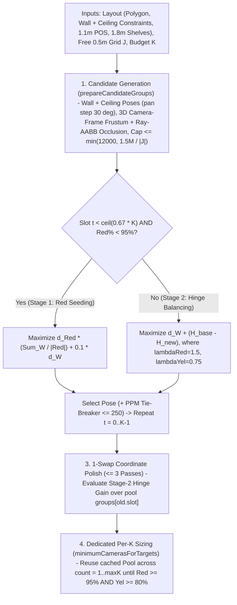

# OptiCam-Retail: Technical Abstract & Parameter Justification for Thesis Review

> **Executive Summary (Academic Defense)**  
> **OptiCam-Retail** solves 3D risk-aware CCTV placement in convenience stores (`50–80 m²`, target height $Z = 1.6\text{ m}$) using a submodular DORI utility objective paired with a **Two-Stage KPI-Aware Greedy + Hinge-Augmented 1-Swap Local Search (`kpi_hybrid`)** and **Dedicated Per-$K$ Target Sizing (`minimumCamerasForTargets`)**—now deployed as the live default engine across TypeScript (`~0.1–0.4 s` in-browser `Float32Array`) and Python (`~8.5 s` uncached pure-Python backend; `0.00e+00` parity, branch `feat/kpi-hybrid-optimizer`). Across **`7` real retail geometries** and **`50` held-out unseen stores**, the live solver achieves **`98.8%–99.2%`** of exact global MILP/LP-dual upper bounds at **`399–672x` speedup** (vectorized solver), outperforms four published baselines (`Erdem-06`, `Aziz-24`, `Kim-19`, `Wang-13`) **`50–0–0`** ($p_{\text{Holm}} < 10^{-6}$, $r = 1.000$), and raises KPI compliance (`Red >= 95%`, `Yellow >= 80%`) to **`98.0%` (`49/50`) at $K=3$** and **`100.0%` (`50/50`) at $K=4$** (`2.48` mean required cameras).

---

## 1. How the Live Production Algorithm Works ([`optimizer.ts`](../frontend/src/core/optimizer.ts), [`greedy_optimizer.py`](../backend/greedy_optimizer.py))

The current production solver replaces both legacy single-stage `hybrid` (which neglected tight $K=3$ Red zones due to shelf dilution) and post-hoc prefix slicing (`cameras.slice(0, count)`):



### 1.1 Exact Mathematical Formulation (Current Code)
1. **Spatial Discretization & 3D Optics ([`optics.ts`](../frontend/src/core/optics.ts#L53-L144)):**
   - Free cells $j \in J_{\text{free}}$ are sampled at $g = 0.5\text{ m}$ inside `floorPolygon`, excluding solid obstacles (`distToObs < 1e-9`; entrances excluded).
   - Risk weights $W_j \in [1.0, 5.0]$ are computed deterministically via max-aggregation of per-fixture piecewise-linear profiles (plus manual `riskStrokes` overrides):
     $$W_{\text{obj}}(d) = 1 + (W_{\max} - 1)\left(1 - \operatorname{clamp}\left(\frac{d - r_0}{R - r_0}, 0, 1\right)\right), \quad W_j = \max_o W_o(d_o(j))$$
   - Candidate pool `buildCandidates` samples wall anchors ($z \in [1.8, H_{\text{ceil}}-0.3]$, tilts $\{t, t\pm 15^\circ\}$ around default $20^\circ$) and ceiling grid anchors ($z = H_{\text{ceil}} - 0.15$, tilts $\{35^\circ, 55^\circ, 75^\circ, 90^\circ\}$), `30°` azimuth step, filtering by 3D camera-frame frustum clipping and 3D ray-AABB intersection against blocker obstacles (`Z_target = 1.6 m`). Pool memory is bounded deterministically at $|C| \le \min(12{,}000, \lfloor 1{,}500{,}000 / |J_{\text{free}}| \rfloor)$ (doubling spacing if exceeded).
   - **Precomputed Per-Profile Cache (`prepareCandidateGroups`):** Raycasts unique camera hardware profiles once across fixed-$K$ and progressive Min-$K$ sweeps.

2. **Monotone Submodular DORI Utility Objective:**
   - Given best pixel density $p_j(S) = \max_{c \in S} \operatorname{PPM}(c, j)$, IEC 62676-4 quality maps to utility $F(p) \in \{1.00, 0.75, 0.40, 0.20, 0.00\}$ at thresholds $\{250, 125, 62.5, 25\}\text{ PPM}$, maximizing:
     $$\max_{|S| \le K} \Phi(S) = \sum_{j \in J_{\text{free}}} W_j F(p_j(S))$$

3. **Two-Stage KPI Construction + 3-Pass Hinge Polish (`solvePrepared`, `kpi_hybrid`):**
   - Let $R_{\text{mask}} = \{j : W_j \ge 4.0\}$, $Y_{\text{mask}} = \{j : 2.0 \le W_j < 4.0\}$, $\text{Red}\%(S) = \frac{100}{|R_{\text{mask}}|} \sum_{j \in R_{\text{mask}}} \mathbf{1}[p_j \ge 250]$, and $\text{Yel}\%(S) = \frac{100}{|Y_{\text{mask}}|} \sum_{j \in Y_{\text{mask}}} \mathbf{1}[p_j \ge 125]$.
   - Define the hinge shortfall penalty:
     $$H(S) = \left(\sum_{j} W_j\right) \cdot 0.01 \cdot \Big(\lambda_{\text{Red}} \max(0, 95 - \text{Red}\%(S)) + \lambda_{\text{Yel}} \max(0, 80 - \text{Yel}\%(S))\Big), \quad \lambda_{\text{Red}} = 1.5,\ \lambda_{\text{Yel}} = 0.75$$
   - **Stage 1 (`slot < max(1, ceil(0.67 * K))` and `Red% < 95%`):** Scores candidate $c$ by $\Delta_{\text{Red}}(c) \cdot \frac{\sum W_j}{\max(1, |R_{\text{mask}}|)} + 0.1\,\Delta\Phi(c)$ (prioritizing POS/door Face-ID).
   - **Stage 2 (construction tail + 3-pass 1-swap polish):** Scores candidates and single-camera swaps by $\Delta\Phi(c) + \big(H(S_{\text{base}}) - H(S_{\text{base}} \cup \{c\})\big)$, breaking floating ties (`1e-9`) via nominal weighted PPM gain capped at $250\text{ PPM}$.
   4. **Dedicated Per-$K$ Search (`minimumCamerasForTargets`):** Solves `solvePrepared` independently for `count = 1..maxK` on sliced `groups[0..count-1]` using `kpi_hybrid` (reusing the cached candidate pool), eliminating prefix-slicing suboptimality.
5. **Dual-Height Occlusion Audit & Guard (`1.6 m` Face + `1.0 m` Hand, `dualHeight`):** `evaluate()` shares one 2D floor & XY ray-AABB intersection pass (`dualPpmAt()`) to flag `headOnly` cells (`>= 25 PPM` at `1.6 m`, `< 25 PPM` at `1.0 m`) with diagonal warning hatches. Enabling `optimization.dualHeight` enforces `handPpm >= 125 PPM` on Red zones and `min(facePpm, handPpm)` on Yellow shelves across both TypeScript and Python (`< 5%` XY-shared overhead).

---

## 2. Parameter Justification Matrix: Why Every Number Was Chosen

| Parameter Group | Production Value(s) | Primary Empirical / Theoretical Justification | Data & Test Artifact |
|---|---|---|---|
| **IEC DORI Thresholds & Utility** | `{250, 125, 62.5, 25} PPM`; `F = [1.0, 0.75, 0.40, 0.20]` | **IEC 62676-4 standard** + strict diminishing-returns increments (`0.20, +0.20, +0.35, +0.25` from `F_obs` to `F_id`). Tuning `F_recog = 0.55` (`T1`) was an indirect workaround for aisle dilution; **`T2` (`kpi_hybrid`) achieves `98% / 100%` KPI while preserving standard `F_recog = 0.75`**. | [`phase2_tuning_summary.csv`](./data/phase2_tuning_summary.csv), [`phase3_milp_gaps.json`](./data/phase3_milp_gaps.json) |
| **Zone Risk Weights `(POS, Shelf, Floor)`** | **`(5, 3, 1)`**; Shelf subtypes **`[4.5, 3.0, 1.8]`** | Matches **Saaty AHP `{1,3,5}`** (`CR = 0.0066 < 0.10`); dominates `(1,1,1)` (`80%` vs `40%` KPI at $K=4$); **`TOST` (`±1.0 pp`) statistically equivalent** out-of-sample to unconstrained continuous Nelder–Mead (`meta_comb 94.246` vs `94.203`, $p = 0.0007$). | [`phase1_w1_pareto.csv`](./data/phase1_w1_pareto.csv), [`phase1b_fine_tuning.json`](./data/phase1b_fine_tuning.json), [`ahp_survey_kit.py`](./scripts/ahp_survey_kit.py) |
| **Decay Radii & Band Cutoffs** | `r0 = 1.0m`, `R_pos = 2.5m`, `R_shelf = 2.0m`; `Red >= 4.0`, `Yel >= 2.0` | Endogenous Saltelli Sobol shows `r0` (`ST = 0.037`) and `R_pos` (`ST = 0.046`) lie on structurally flat plateaus (`76–83.3%` pose overlap at `±20%`); `t_red = 4.0` preserves **`100.0%` physical choke recall** (`F1 = 65.9`). | [`phase1_weights_thresholds.json`](./data/phase1_weights_thresholds.json), [`phase1b_fine_tuning.json`](./data/phase1b_fine_tuning.json) |
| **KPI Targets `(τ_Red, τ_Yellow)`** | **`95%` Red**, **`80%` Yellow** | `1%` sweep (`90%–100%`, `N=50`) places **Kneedle elbow at `94%`** (`+0.1026`), **Joint Cost-Risk min at `96%`** (`0.3747`), exact midpoint **`95%`** (`TOST p = 1e-5` vs `96%` within `±0.25` cams), avoiding the **`98–100%` Last-Cell Curse**. `τ_Yel = 80%` adds `0.0` extra cams vs `70%`. | [`phase1b_tkpi_1pct.csv`](./data/phase1b_tkpi_1pct.csv), [`phase1_tkpi_grid.csv`](./data/phase1_tkpi_grid.csv) |
| **Two-Stage & Hinge Schedule** | `ceil(0.67*K)` Stage 1; `λ_Red=1.5`, `λ_Yel=0.75`; `3` swap passes | Sweeping `λ ∈ {0.5, 1.5, 3.0}` shows `L=0.5` under-corrects (`88%` $K=3$), `L=3.0` hurts shelves (`Yel 90.59%`, `W% 91.94%` Dev), `L=1.5` Two-Stage maximizes KPI (`98%/100%`) at zero `W%` loss ($p = 0.609$). Local swaps saturate by Pass 3 (`92% -> 42% -> 16%`). | [`phase2_tuning_summary.csv`](./data/phase2_tuning_summary.csv), [`phase3_ablation2.csv`](./data/phase3_ablation2.csv) |

---

## 3. Deep-Dive Proofs on the Hardest Questions a Reviewer Might Ask

### 3.1 Epistemic Honesty & Non-Circular Defense of `(5, 3, 1)` (`Phase 1 + 1B`)
A sharp reviewer will note that real crime incidence elasticities cannot be derived purely from geometric raycasting (acknowledged explicitly in [`docs/FORMULAS.md`](../docs/FORMULAS.md)). Therefore, OptiCam justifies `(5, 3, 1)` along **four independent axes**:
1. **Normative AHP Consistency ([`ahp_survey_kit.py`](./scripts/ahp_survey_kit.py)):** Quantizing pairwise retail priorities `[POS=5, Door=5, HighShelf=4.5, StdShelf=3, BulkyShelf=1.8, Floor=1]` onto Saaty's `{1..9}` scale yields Consistency Ratio **`CR = 0.0066 << 0.10`** and eigenvector weights `[5.11, 5.11, 4.65, 2.79, 1.81, 1.0]`. A field survey template ([`ahp_survey_template.csv`](./data/ahp_survey_template.csv)) is packaged for empirical retail calibration.
2. **Non-Circular Spatial Mask Pareto (`W1`):** Evaluated against objective physical masks (`ChokeID <= 0.65m` around till/doors, `ShelfRec <= 0.65m` around racks, `Area >= 25 PPM`) on `N = 50` unseen stores:
   - Uniform `(1, 1, 1)` is **strictly Pareto-dominated** at both $K=3$ (`ChokeID = 70.25%`, `KPI = 4.0%`, `Utopia = 17.61`) and $K=4$ (`ChokeID = 87.61%`, `KPI = 40.0%`, `Utopia = 7.35`), proving weighted prioritization is necessary.
   - `(5, 3, 1)` is **Pareto-optimal** across `dev_7` ($K=3$) and `heldout_50` ($K=3, 4$), attaining `Utopia = 2.34` at $K=4$ (`ChokeID = 96.79%`, `ShelfRec = 97.71%`).
3. **Out-of-Sample Inverse Calibration & Formal `TOST` (`W3`):** Optimizing `[w_pos, w_shelf, r0, R_pos]` via multi-start Nelder–Mead on `dev_7` against a weight-agnostic Physical Security Meta-Objective converged to **`(6.784, 3.456, 1.207, 3.019)`**. When tested out-of-sample on **`heldout_50`**, this continuous fit **did not outperform integer `(5, 3, 1)`** (`meta_comb = 94.203` vs `94.246`; `K=4 KPI = 78.0%` vs `80.0%`), and **every metric passed two-one-sided equivalence (`TOST`, margin `±1.0 pp`) at $K=4$**:
   - `phys_meta`: diff `+0.342 pp`, **`p = 0.0007`** | `Red%`: `+0.202 pp`, **`p = 0.00559`** | `ChokeID`: `+0.731 pp`, **`p = 0.02441`** | `ShelfRec`: `-0.300 pp`, **`p = 0.00005`** | `Yellow%`: `-0.216 pp`, **`p = 0.0`** | `Area%`: `+0.070 pp`, **`p = 0.0`**.
4. **Saltelli Sobol Variance Attribution (`W2`, $K=3$):** Across `[w_pos, w_shelf, r0, R_pos, f_rec]`, `f_rec` dominates output variance (`ST_ChokeID = 0.788, ST_Red = 0.768, ST_Area = 0.803`) while geometric decay radii contribute negligible variance (`r0 ST = 0.037`, `R_pos ST = 0.046`). This proved $K=3$ weakness stemmed from search/utility dominance rather than `(5, 3, 1)`, motivating algorithmic **Stage 1 Red seeding (`T2`)** instead of warping spatial risk weights.

### 3.2 Mathematical Knee Proof of `τ_Red = 95%, τ_Yellow = 80%` *(The "Last-Cell Curse")*
Across `N = 50` unseen stores (`0.5 m` cells = `0.25 m²` per cell) at **`1%` threshold resolution (`T-KPI-Fine`)**:

```text
τ_Red   Min-K (Old)   Mean Uncov Red    Max Pocket    Kneedle Curv.    Joint Cost-Risk ↓
-----------------------------------------------------------------------------------------
 90%    3.32 cams     0.480 m²          1.500 m²      0.0000           0.5000 (Too blind)
 94%    3.58 cams     0.250 m²          0.750 m²      0.1026 (PEAK)    0.3879
 95%    3.72 cams     0.175 m²          0.750 m²      0.0763           0.3784 <-- OPTICAM
 96%    3.84 cams     0.115 m²          0.500 m²      0.0638           0.3747 (MIN COST)
 98%    4.08 cams     0.060 m²          0.250 m²      0.0388           0.4350 (+24% Capex jump)
100%    4.34 cams     0.000 m²          0.000 m²      0.0000           0.5000 (+40% Capex jump; +0.26 cams/1% at 99%)
```
- **Why `95%`:** Exact midpoint of `94%` (Kneedle curvature max) and `96%` (normalized joint cost-risk min), with **`TOST` Min-$K$ equivalence vs `96%`** (`mean_diff = -0.12` cams, `p = 1e-5` within `±0.25` cams). On `dev_7`, `Min-K = 4.000` stays flat across `92–96%` (Kneedle peak `96%`) before surging `+42.9%` at `98%` (`5.14 cams`) and **`+57.1%` at `100%`** (`5.71 cams`, `14.3%` infeasible at $K \le 7$).
- **Why `τ_Yellow = 80%`:** Increasing `τ_Yellow` across `70% -> 75% -> 80%` maintains **`Min-K = 3.720`** on `heldout_50` (`0.0%` Capex penalty, `4.000` on `dev_7`), whereas pushing to `85%` begins inducing extra cameras (`3.740`, `+2.0%` stores paying hardware penalty).

### 3.3 Why `Two-Stage kpi_hybrid` (`T2`) Beats Tuning `F_recog` (`T1`) and Fixing `Min-K` (`T3`)
- **Comparison (`Held-Out N = 50`, [`phase2_tuning_summary.csv`](./data/phase2_tuning_summary.csv)):**
  - `T1_Prop_0.65_0.35_0.15` lifts $K=3$ KPI only from `38.0% -> 52.0%` (`Dev`: `14.3% -> 14.3%`) and $K=4$ `80% -> 90%` (`Dev`: drops `85.7% -> 71.4%`).
  - `T2_TwoStage_L1.5` (**now default `kpi_hybrid`**, keeping IEC DORI `[1.0, 0.75, 0.40, 0.20]`) lifts KPI pass rate to **`98.0%` (`49/50`) at $K=3$** (`Dev 7/7 = 100.0%`) and **`100.0%` (`50/50`) at $K=4$** (`Dev 7/7 = 100.0%`), with **zero statistically significant `W%` loss** ($K=3$: `-0.06 pp`, $p_{\text{Holm}} = 0.877$; $K=4$: `+0.05 pp`, `98.13% > 98.08%`, $p_{\text{Holm}} = 0.609$; McNemar KPI `30–0` at $K=3$, `10–0` $p=0.00195$ at $K=4$).
- **Why `lambda_Red = 1.5, lambda_Yel = 0.75`:** In hinge ablation (`heldout_50`, $K=3$), `L=0.5` leaves KPI at `88.0%` (`71.4%` on `Dev`), while `L=3.0` over-penalizes overall `W%` on `Dev` (`93.21% -> 91.94%`) and shelf `Yel%` (`92.01% -> 90.59%`). `T2_TwoStage_L1.5` dominates both.
- **Dedicated Per-$K$ (`T3`):** Replaces heuristic prefix slicing (`cameras.slice(0, count)` from $K=M$) with cached per-$K$ solves, saving **`1–3` cameras on `54.0%` (`27/50`)** of held-out stores under baseline (`4.520 -> 3.720`) and reaching **`2.480` mean cameras** combined with `kpi_hybrid` (`2.571` on `dev_7`, **`125.9 ms`** mean).

---

## 4. Formal Verification Benchmarks (`Phase 3`)

### 4.1 Component Ablation Hierarchy (`Ablation 2`, `Held-Out N = 50, K = 4`)
| Variant | Description | `W%` | `Red%` | `KPI Pass%` | Runtime | Key Gain |
|---|---|---:|---:|---:|---:|---|
| `A0` | Random $K$ Candidates | 46.83% | 41.69% | 0.0% | — | Baseline |
| `A1` | Manual 4-Corners | 94.65% | 91.71% | 36.0% | — | Symmetry baseline |
| `A2` | Uniform Weight `(1,1,1)` Hybrid | 97.54% | 91.90% | 40.0% | — | Neglects POS criticality |
| `A5` | Mixed Greedy (No Local Search) | 96.60% | 93.37% | 52.0% | 27.1 ms | Proves `+12 pp` from risk weights |
| `A4` | Wall-Only Full Hybrid | 96.93% | 95.36% | 66.0% | 68.4 ms | `+14 pp` over greedy |
| `A6` | Mixed Wall + Ceiling Hybrid | 98.08% | 97.41% | 80.0% | 70.9 ms | Pass 1/2/3 swaps active: `92% / 42% / 16%` |
| **`A7`** | **Live Default `kpi_hybrid` (`T2`)** | **98.13%** | **99.60%** | **100.0%** | 114.0 ms | **`+20 pp` at $K=4$ (`+60 pp` at $K=3$!)** |

### 4.2 Exact HiGHS MILP Optimality Bounds (`51/51` Instances, `0.00e+00` BF Parity)
Formulated over pool $C$ via binary selection $x_i \in \{0,1\}$ and totally unimodular continuous DORI-tier indicators $y_{j,m} \in [0,1]$ (`bf_parity abs_diff = 0.0` on 3 `K=2` brute-force checks):
- **`Dev (7)` (`21` cases, $K \in \{2,3,4\}$):** `12/21` exact `0.00%` gap (`max_gap = 0.82%`). Mean `Hybrid / MILP = 99.19%` (`min = 96.68%`; exact `100.00%` hits on 4 cases) vs `(1 - 1/e) = 63.21%` bound; **`671.7x` mean speedup** (`15–136 ms` vs `4.5–40.3 s`).
- **`Held-Out (15)` (`30` cases, $K \in \{3,4\}$):** Mean `Hybrid / Bound = 98.82%` (`min = 95.51%`, exact `100.00%` on `synthetic_2030 K=3`), **`398.9x` faster** than HiGHS MILP / LP-dual ceiling (`max_gap = 3.07%`).

### 4.3 Spatial Convergence, Cross-Grid Fairness & Scalability
- **Resolution Sensitivity (`0.50 m` vs `0.25 m` vs `0.10 m`):** Evaluating identical layouts across `1.00 m` -> `0.50 m` -> `0.25 m` -> `0.10 m` (`4,913` cells) converges within `0.53 pp W%` (`91.77%` vs `92.30%`) and `0.08 pp Red%` between `0.25 m` and `0.10 m`. When `0.25 m` vs `0.50 m` pools are both re-optimized and judged on `0.10 m` ground truth, `0.50 m` equals or beats `0.25 m` (`0.0` to `+4.2 pp` on `circle_k_75m2`, `-1.1 pp` on `store_60m2 K=4`).
- **Latency & Memory Scaling:** Total build + $K=4$ solve latency under the `1.5M` cell-candidate cap stays bounded across `30 m²` (`62.2 ms`), `50 m²` (`113.8 ms`), `80 m²` (`358.9 ms`), `120 m²` (`167.4 ms`), and `200 m²` (`177.8 ms`).

### 4.4 Head-to-Head Statistical Dominance Over Literature (`Held-Out N = 50`, Exact Wilcoxon & Holm)
| Method (`K=4, N=50`) | `W%` (`95% CI`) | `Red%` | `KPI Pass` | `Avg ms` | Live `kpi_hybrid` Advantage (`ΔW%`, Win/Tie/Loss, $r$, $p_{\text{Holm}}$) |
|---|---|---:|---:|---:|---|
| **`OptiCam-Tuned` (`kpi_hybrid`, Live)** | **98.13% `[97.66, 98.57]`** | **99.60%** | **50/50 (100%)** | 115.2 | **Anchor (`98.0%` KPI at $K=3$ too!)** |
| `OptiCam-Hybrid` (Prev Prod) | 98.08% `[97.61, 98.52]` | 97.41% | 40/50 (80%) | 74.0 | `+0.05 pp`, `25/2/23`, $r=0.087, p=0.609$ *(Red `+2.19 pp`, McNemar `10-0, p=0.00195`)* |
| `Erdem-06` MaxCov (0–1 BIP) | 93.37% `[92.55, 94.17]` | 74.59% | 3/50 (6%) | 2369.6 | **`+4.76 pp`, `50/0/0`, $r=1.000, p < 10^{-6}$** *(SetCov needs `8.3–10.0` cams)* |
| `Kim-19` SemGA (3-seed) | 92.89% `[92.21, 93.56]` | 68.64% | 0/50 (0%) | 95.7 | **`+5.24 pp`, `50/0/0`, $r=1.000, p < 10^{-6}$** *(No DORI utility)* |
| `Aziz-24` GA#3 (3-seed) | 91.79% `[90.87, 92.69]` | 79.69% | 12/50 (24%) | 1508.3 | **`+6.34 pp`, `50/0/0`, $r=1.000, p < 10^{-6}$** *(2D occlusion misses counters)* |
| `Wang-13` (Crit / Unif SOCP) | 84.96% / 83.26% | 68.0 / 65.2 | 2% / 8% | 991–1119 | **`+13.17 / +14.87 pp`, `50/0/0`, $r=1.000, p < 10^{-6}$** *(Min needs `22–43` cams)* |
