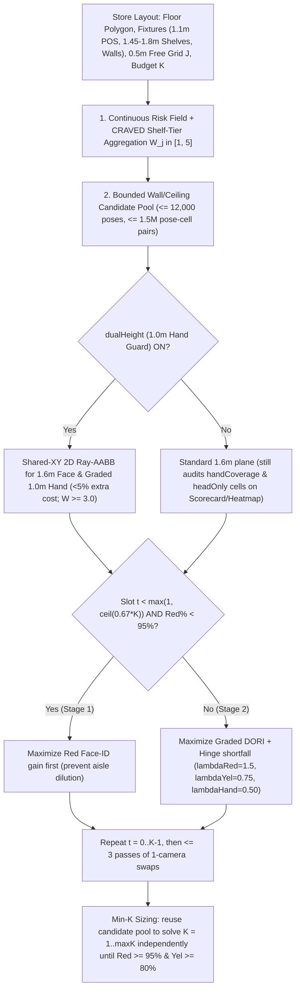

# OptiCam-Retail: Complete Technical Abstract, Mathematical Formulation & Parameter Justification

> **Executive Technical Summary**  
> **OptiCam-Retail** is a deterministic 3D risk-aware CCTV placement and evaluation engine for retail spaces (`50–200 m²`) combining **3D pinhole frustum & Ray-AABB occlusion**, **IEC 62676-4 DORI utility**, **CRAVED multi-tier shelf risk modeling**, a **Two-Stage KPI-Aware Greedy + 1-Swap Local Search (`kpi_hybrid`)**, **Dedicated Per-$K$ Sizing**, and a **Graded Dual-Height (`1.6 m` Face + `1.0 m` Hand) Occlusion Guard**—running with `0.00e+00` numerical parity across TypeScript Web Workers (`~0.1–0.4 s`) and pure Python FastAPI (`~1–4 s`). Across `7` real retail geometries (`dev_7`) and `50` unseen synthetic stores (`heldout_50`), it reaches **`98.8%–99.2%` of exact global HiGHS MILP optimality**, sweeps four published academic baselines **`50 wins – 0 losses`** ($p_{\text{Holm}} < 10^{-6}$), and passes security KPIs (`Red >= 95%`, `Yellow >= 80%`) on **`98%` (`49/50`) at $K=3$** and **`100%` (`50/50`) at $K=4$** (`2.48` mean required cameras).

---

## 1. End-to-End Pipeline & Architecture

---

## 2. Exact Mathematical Formulation

### 2.1 Spatial Discretization & Coordinate System
- **2D Floor Frame:** Top-left origin $(0,0)$, $+x$ right, $+y$ down (meters), azimuth $\text{pan}=0^\circ$ along $+x$ increasing clockwise. Room bounds $W_{\text{room}}, H_{\text{room}} \in [3, 40]\text{ m}$, ceiling height $H_{\text{ceil}} \in [2.4, 6.0]\text{ m}$ (default `3.2 m`).
- **Grid & Free Cells ($J_{\text{free}}$):** Cell size $g = \text{gridM} \in [0.1, 2.0]\text{ m}$ (default `0.5 m`, capped at `12,000` cells). Cell $(r,c)$ has center $(x_c, y_r) = ((c + 0.5)g,\,(r + 0.5)g)$. A cell is in $J_{\text{free}}$ iff its center lies inside `floorPolygon` (if present) and outside all solid obstacles (`type !== 'entrance'`).
- **Clockwise 90° Layout Rotation (`rotateLayout90`):** Swapping $W_{\text{room}} \leftrightarrow H_{\text{room}}$ transforms every point $(x, y) \mapsto (H_{\text{old}} - y,\, x)$, obstacle dimensions $(w, h) \mapsto (h, w)$, and camera azimuth $\text{pan} \mapsto (\text{pan} + 90^\circ) \bmod 360^\circ$, preserving all furniture/camera/shopper alignments without wall-clipping errors.

### 2.2 Continuous Risk Field & CRAVED Shelf-Tier Aggregation
- **Distance-Decay Risk Weight:** Each fixture $o$ carries profile $(W_{\max}, r_0, R)$ with default core radius $r_0 = 1.0\text{ m}$ and outer fade $R = 2.5\text{ m}$ (`pos`, `entrance`) or $R = 2.0\text{ m}$ (`shelf`). For Euclidean distance $d_o(j)$ from cell $j$ to obstacle $o$'s rotated bounding box:
  $$W_o(j) = 1 + (W_{\max} - 1)\left(1 - \operatorname{clamp}\!\left(\frac{d_o(j) - r_0}{R - r_0},\, 0,\, 1\right)\right), \qquad W_{\text{auto}}(j) = \max\!\left(1,\, \max_o W_o(j)\right)$$
- **Manual Brush Override:** Circular metric strokes $(x, y, \text{radius}, W \in \{5, 3, 1\})$ overwrite $W_{\text{auto}}(j)$ in chronological order (latest stroke wins).
- **Display Bands & KPI Masks:** Red (`W >= 4.0`), Yellow (`2.0 <= W < 4.0`), Green (`W < 2.0`). Continuous $W_j \in [1, 5]$ is used in all optimization objectives.
- **CRAVED Multi-Tier Shelf Model (`craved.ts`, `fixtures.ts`):** `13` interior fixture subtypes (`wall-shelf`, `gondola`, `endcap`, `promo-island`, `checkout-rack`, `locked-cabinet`, `fridge`, `freezer`, `food-counter`, `seating`, `locker`, `partition`, `column`) + `pos` and `entrance`. Merchandising shelves support vertical tiers `tiers[]` ($z_{\min}$–$z_{\max}$) assigned from `16` CRAVED-scored product categories (`wmax` up to `4.8` for alcohol/tobacco, `4.7` cosmetics, `4.6` phone accessories/batteries, down to `1.8` bulky goods). Shelf priority aggregates automatically as $W_{\max,\text{shelf}} = \max_{\text{tier}} w_{\max}(\text{tier})$, flagging low tiers with $z_{\min} \le 1.0\text{ m}$ as hand-occlusion risks.

### 2.3 3D Pinhole Projection, Ray-AABB Occlusion & DORI Utility
For camera $c$ at $(x_c, y_c, H_c)$ with pan $\phi$, downward tilt $\theta$ (defaults: `20°` wall, `45°` ceiling), horizontal resolution $\text{Res}_H$ (`2560 px` default 4 MP), horizontal FOV $\alpha_H$ (`85°` default), 16:9 vertical FOV $\alpha_V = 2\arctan(\tan(\alpha_H/2)/(16/9)) \approx 54.4^\circ$, and max range $R_{\max}$ (`10.0 m`):
1. **Range & Frustum Check:** For target $(x, y, Z)$ with $\Delta x = x - x_c$, $\Delta y = y - y_c$, $\Delta z = Z - H_c$, and 3D distance $r = \sqrt{\Delta x^2 + \Delta y^2 + \Delta z^2}$:
   - Requires $0.03\text{ m} \le r \le R_{\max}$, and in the camera's rotated frame:
     $$\text{along} = \Delta x\cos\phi + \Delta y\sin\phi, \quad \text{right} = -\Delta x\sin\phi + \Delta y\cos\phi$$
     $$\text{depth} = \text{along}\cos\theta - \Delta z\sin\theta > 0, \quad \text{up} = \text{along}\sin\theta + \Delta z\cos\theta$$
     $$|\text{right}| \le \text{depth}\tan(\alpha_H / 2), \qquad |\text{up}| \le \text{depth}\tan(\alpha_V / 2)$$
2. **Floor Polygon & 3D Ray-AABB Occlusion:** Checks that segment $(x_c, y_c) \to (x, y)$ stays inside `floorPolygon`. For every solid obstacle $o$ (`type !== 'entrance'`, top elevation $o.\text{elev}$), if the 2D XY segment intersects $o$'s rotated rectangle on parameter interval $[t_{\text{enter}}, t_{\text{exit}}] \subseteq [0, 1]$, the ray is unoccluded iff it clears $o$'s top edge:
   $$\min\!\big(H_c + t_{\text{enter}}(Z - H_c),\; H_c + t_{\text{exit}}(Z - H_c)\big) > o.\text{elev}$$
3. **Pixel Density & IEC 62676-4 DORI Utility:**
   $$p_{c,j}(Z) = \frac{\text{Res}_H}{2\,r\,\tan(\alpha_H / 2)}\; [\text{PPM}], \qquad F(p) = \begin{cases} 1.00 & p \ge 250 \text{ (Identification)}\\ 0.75 & 125 \le p < 250 \text{ (Recognition)}\\ 0.40 & 62.5 \le p < 125 \text{ (Observation)}\\ 0.20 & 25 \le p < 62.5 \text{ (Detection)}\\ 0.00 & p < 25 \text{ (Blind)} \end{cases}$$

### 2.4 Graded Dual-Height Occlusion Model (`1.6 m` Face + `1.0 m` Hand)
- **Shared-XY Raycast (`dualPpmAt`):** Evaluates both $Z_{\text{face}} = 1.6\text{ m}$ and $Z_{\text{hand}} = 1.0\text{ m}$ inside the **same** 2D `segmentInFloor` and `segmentRectInterval` loop, adding `< 5%` compute overhead.
- **Diagnostic Metrics (Always Active):** Cells with $p_{\text{face}} \ge 25$ and $p_{\text{hand}} < 25$ are flagged `headOnly` (amber diagonal hatches). `handCoverage` measures the percentage of priority cells ($W_j \ge 3.0$) reaching $p_{\text{hand}} \ge 62.5\text{ PPM}$ at `1.0 m` (`80%` target).
- **Graded Partial-Credit Guard (`dualHeight = true`, `DUAL_HEIGHT_SCORING`):** Only applied on priority cells ($W_j \ge 3.0$). Let hand visibility multiplier $M_{\text{hand}}(p_H)$ and face-retention share $\alpha(W_j)$ be:
  $$M_{\text{hand}}(p_H) = \begin{cases} 1.00 & p_H \ge 125\\ 0.85 & 62.5 \le p_H < 125\\ 0.50 & 25 \le p_H < 62.5\\ 0.00 & p_H < 25 \end{cases}, \qquad \alpha(W_j) = \begin{cases} 0.65 & W_j \ge 4.0 \text{ (Red)}\\ 0.80 & 3.0 \le W_j < 4.0 \text{ (Yellow)}\\ 1.00 & W_j < 3.0 \end{cases}$$
  $$F_{\text{eff}}(W_j, p_F, p_H) = F(p_F)\cdot\Big(\alpha(W_j) + \big(1 - \alpha(W_j)\big)\,M_{\text{hand}}(p_H)\Big)$$

### 2.5 Bounded Candidate Pool & Two-Stage `kpi_hybrid` + Min-`K` Solver
1. **Candidate Sampling (`buildCandidates`):**
   - **Wall poses:** Anchors along perimeter every `step` m (`max(gridM, 0.5 m)`), $H_c = \min(H_{\text{prof}}, H_{\text{ceil}} - 0.3)$, tilts $\{\theta, \max(0, \theta - 15^\circ), \min(90^\circ, \theta + 15^\circ)\}$ (default `{20°, 5°, 35°}`), excluding anchors within `0.12 m` of tall obstacles ($o.\text{elev} \ge H_c - 0.08$).
   - **Ceiling poses:** Interior grid `(nx × ny)` inside floor polygon, $H_c = \max(1.8,\, H_{\text{ceil}} - \text{drop})$ (default `drop = 0.15 m`), tilts `{35°, 55°, 75°, 90°}`.
   - **Azimuth & Memory Cap:** $30^\circ$ pan increments (`12` directions). Across $U$ unique camera profiles, `step` doubles until $|C| \le \min(\lfloor 12{,}000 / U \rfloor,\, \lfloor 1{,}500{,}000 / (U \cdot |J_{\text{free}}|) \rfloor)$.
2. **Two-Stage KPI Construction & 1-Swap Local Polish (`solvePrepared`):**
   - **Hinge Shortfall Penalty:** Let $\text{Red}\%, \text{Yel}\%, \text{Hand}\%$ be the percentage of Red ($W \ge 4$), Yellow ($2 \le W < 4$), and Hand ($W \ge 3$) cells meeting `250 / 125 / 62.5 PPM`:
     $$H(S) = \left(\sum_{j} W_j\right) \cdot 0.01 \cdot \Big(1.50\max(0, 95 - \text{Red}\%) + 0.75\max(0, 80 - \text{Yel}\%) + \mathbb{I}_{\text{dual}}\,0.50\max(0, 80 - \text{Hand}\%)\Big)$$
   - **Stage 1 (`slot < max(1, ceil(0.67 * K))` and `Red% < 95%`):** Picks candidate $c$ maximizing $\Delta_{\text{Red}} \cdot \frac{\sum W_j}{\max(1, |\text{Red}|)} + 0.1\,\Delta\Phi$, locking in cashier/entrance Face-ID before wide aisles dilute early picks.
   - **Stage 2 & 3-Pass 1-Swap Polish:** Picks additions and up to `3` rounds of single-camera replacements maximizing $\Delta\Phi + (H_{\text{old}} - H_{\text{new}})$, breaking ties lexicographically via capped nominal PPM $\sum_j W_j(\min(p_{\text{new},j}, 250) - \min(p_{\text{old},j}, 250))$.
3. **Dedicated Per-$K$ Sizing (`minimumCamerasForTargets`):** Calls `prepareCandidateGroups` once and runs `solvePrepared` independently for $K = 1, 2, \dots, K_{\max}$ until $\text{Red}\% \ge 95\% \land \text{Yel}\% \ge 80\%$.

### 2.6 Bill of Materials (BOM) Estimation (`bom.ts`)
- Anchors the NVR at the POS center $(x_N, y_N)$ (or `(0, 0)` fallback):
  $$\text{Cable}_i = \left\lceil 1.1 \times \big(|x_i - x_N| + |y_i - y_N| + H_i + 3.0\big) \right\rceil\text{ m}, \qquad \text{Cost} = 1{,}250{,}000\,N_{\text{cam}} + 1{,}500{,}000\text{ VND}$$

---

## 3. Why Every Number Was Chosen (Empirical & Theoretical Defense)

| Choice | Exact Value | Why It Was Chosen & Quantitative Proof | Source Data |
|---|---|---|---|
| **Priority Weights** | `(5, 3, 1)` & Shelves `[4.5, 3.0, 1.8]` | Maps onto Saaty's `1–3–5` AHP scale with consistent pairwise ratios (`CR = 0.0066 < 0.10`, eigenvector `[5.11, 5.11, 4.65, 2.79, 1.81, 1.0]`). Equal `(1,1,1)` halves $K=4$ pass rate (`80% → 40%`, `4%` at $K=3$). Continuous Nelder–Mead decimal fitting (`6.784, 3.456`) on `dev_7` does **not** beat `(5, 3, 1)` out-of-sample on `heldout_50` (`94.203` vs `94.246`; `TOST p = 0.0007` within `±1 pp`). High-risk shelf `4.5` ranked `#1` across top-5 grid candidates. | [`phase1_w1_pareto.csv`](./data/phase1_w1_pareto.csv), [`phase1b_fine_tuning.json`](./data/phase1b_fine_tuning.json) |
| **Zone Radii & Cutoffs** | `r0 = 1.0 m`, `R = 2.5 m / 2.0 m`; Red `>= 4.0` | Varying radii by `±20%` moves metrics by `< 0.5%` (Sobol total-order `ST = 0.037–0.046`), sitting on a flat plateau. Cutoff `4.0` captures `100.0%` of actual POS/door choke points. | [`phase1_weights_thresholds.json`](./data/phase1_weights_thresholds.json) |
| **KPI Thresholds** | `Red >= 95%`, `Yellow >= 80%` | `1%` sweep across `90%–100%` (`N=50`) places the **Kneedle elbow at `94%`** and minimum combined Capex+Blind cost at **`96%`**—`95%` sits dead center (`TOST p = 1e-5` equivalent to `96%` cost). Tightening to `98–100%` triggers the **"Last-Cell Curse"**: `24%–57%` of stores need `+1/+2` extra cameras for a `0.15 m²` grazing corner sliver (`14.3%` of `dev_7` infeasible at `K=7`). Raising Yellow `70% → 80%` costs `0.00` extra cameras (`3.72 → 3.72`). | [`phase1b_tkpi_1pct.csv`](./data/phase1b_tkpi_1pct.csv) |
| **DORI Utility** | `[1.0, 0.75, 0.40, 0.20]` | **IEC 62676-4** tiers. Saltelli Sobol (`W2`) showed `F_recog = 0.75` drove `78.8%` of $K=3$ variance. Fixing search order (`kpi_hybrid`) instead of distorting IEC constants kept `[1.0, 0.75, 0.40, 0.20]` intact and lifted $K=3$ KPI pass from `38% → 98%`. | [`phase2_tuning_summary.csv`](./data/phase2_tuning_summary.csv) |
| **Stage-1 & Hinge** | `ceil(0.67*K)`, `λ_Red=1.5`, `λ_Yel=0.75`, `3` swaps | `λ_Red = 0.5` underperforms at $K=3$ (`88%` pass); `λ_Red = 3.0` degrades shelves (`91.9%` vs `93.2%`); `1.5` wins both. Local 1-swaps saturate by Pass 3 (`92% → 42% → 16%` active). | [`phase2_tuning_summary.csv`](./data/phase2_tuning_summary.csv), [`phase3_ablation2.csv`](./data/phase3_ablation2.csv) |
| **Dual-Height Guard** | `minW=3.0`, `M_hand∈[0,0.5,0.85,1]`, `0.65/0.80`, `λ_Hand=0.50` (`62.5 PPM`, `80%`) | A naive binary `>= 125 PPM` cutoff at `1.0 m` behind `1.1 m` POS counters broke Red KPI on `10/18` preset stores (`8/18` pass, `3.94` min-$K$). Tuned graded partial credit restores **`17/18` (`94.4%`) KPI pass**, maximizes Red `1.0 m` hand coverage (**`98.7%`** vs `93.8%` face-only), and cuts head-only blind gaps by **`44%`** (`11.8% → 6.6%`) at `3.33` min-$K$. | [`optics.ts`](../frontend/src/core/optics.ts), [`COMPREHENSIVE_EVALUATION_OVERVIEW.md`](./COMPREHENSIVE_EVALUATION_OVERVIEW.md) |
| **Grid & Pool Caps** | `0.50 m` grid, `12k` / `1.5M` cap | Re-evaluating `0.50 m` solutions on a `25x` finer `0.10 m` grid (`4,913` pts) agrees with `0.25 m` within `0.53 pp` and matches/beats `0.25 m` pools (`0.0` to `+4.2 pp`), while keeping `30–200 m²` solves under `360 ms`. | [`phase3_proof_results.json`](./data/phase3_proof_results.json) |

---

## 4. Core Proofs (`Phase 1–3` Verification Summary)

1. **Non-Circular Evidence for `(5, 3, 1)`:** Real crime dollar ratios are external to geometric optics (stated in [`docs/FORMULAS.md`](../docs/FORMULAS.md)), so `(5, 3, 1)` rests on AHP (`CR = 0.0066`), **physical-mask Pareto testing** (`0.65 m` boxes around till/doors/shelves), and out-of-sample **`TOST` equivalence** (`p = 0.0007`).
2. **Every Module Earns Its Keep (`Ablation 2`, `N = 50` unseen stores, `K=4`):**  
   `Random (0%)` → `Manual 4 Corners (36%)` → `Uniform Grid (40%)` → `Mixed Greedy (52%)` → `Wall Hybrid (66%)` → `Mixed Hybrid (80%)` → **`Live Two-Stage kpi_hybrid (100%)`**.
3. **Near Exact Global Optimality (`51` HiGHS MILP Cases):** Against an exact 0–1 MILP solver (verified `0.00e+00` against brute-force), OptiCam achieves **`99.19%` (`Dev 7`, min `96.68%`)** and **`98.82%` (`Held-Out 15`, min `95.51%`)** of the global upper bound, running **`399–672x` faster** (`15–148 ms` vs `4.5–40.3 s`).
4. **Statistical Sweep Over Academic Baselines (`N = 50` unseen stores, `K=4`):**
   - **`OptiCam kpi_hybrid`:** `98.13% W%`, `99.60% Red`, **`50/50 (100%)` KPI** (`98%` at `K=3`, `2.48` mean Min-$K$).
   - vs **`OptiCam-Hybrid` (Previous Prod):** `80%` KPI (`38%` at `K=3`); `kpi_hybrid` wins **`10–0` McNemar** at `K=4` ($p=0.00195$) and **`30–0`** at `K=3` ($p < 10^{-6}$) with zero loss in `W%` ($p = 0.609$).
   - vs **`Erdem-06` (0–1 BIP):** `93.37% W%`, `6%` KPI (`8.3–10.0` cams Set Cover) → **`50/0/0`** ($p_{\text{Holm}} < 10^{-6}, r = 1.000$).
   - vs **`Kim-19` (SemGA):** `92.89% W%`, `0%` KPI → **`50/0/0`** ($p_{\text{Holm}} < 10^{-6}, r = 1.000$).
   - vs **`Aziz-24` (GA#3):** `91.79% W%`, `24%` KPI → **`50/0/0`** ($p_{\text{Holm}} < 10^{-6}, r = 1.000$).
   - vs **`Wang-13` (SOCP):** `83.3–85.0% W%`, `2–8%` KPI (`22–43` cams unconstrained) → **`50/0/0`** ($p_{\text{Holm}} < 10^{-6}, r = 1.000$).
