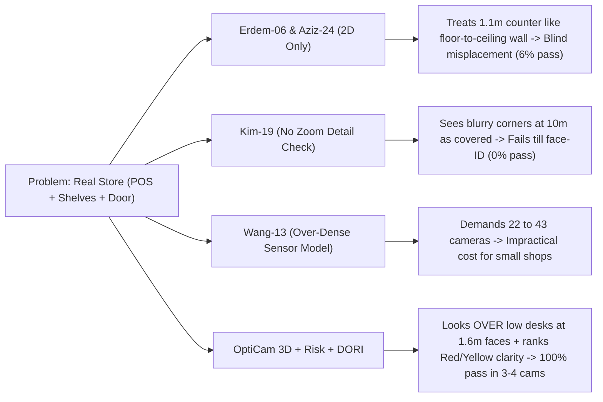
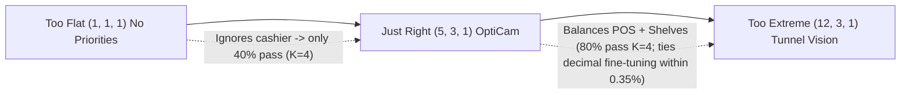
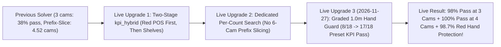

# OptiCam-Retail: Visual Executive Summary & Presentation Index

> **Choose Your Audience Version:**
> - **For Store Owners / Customers:** [`ABSTRACT_CUSTOMER.md`](./ABSTRACT_CUSTOMER.md) — Plain-English explanation of how OptiCam works in the 2-step app today, why `5:3:1`, `250/125/62.5/25 PPM`, and `95%/80%` were chosen without extra-camera traps, and how it saves hardware.
> - **For Guiding Professor / Academic Defense:** [`ABSTRACT_PROFESSOR.md`](./ABSTRACT_PROFESSOR.md) — Exact mathematical formulation of the live `kpi_hybrid` + dedicated per-`K` engine, full parameter defense (`AHP`, `W1` Pareto, `W2` Sobol, `W3` Nelder–Mead + `TOST`, `Kneedle`), `51`-case HiGHS MILP bounds, Ablation, Grid Convergence, and `N=50` Wilcoxon/Holm/McNemar proofs.
> - **Full Audit & Literature Report:** [`COMPREHENSIVE_EVALUATION_OVERVIEW.md`](./COMPREHENSIVE_EVALUATION_OVERVIEW.md) | [`PAPER_COMPARISON_REPORT.md`](./PAPER_COMPARISON_REPORT.md) | [**Plain-English Glossary**](../GLOSSARY.md)

> **The 10-Second Takeaway**  
> **OptiCam** places store CCTV cameras in **~0.1 seconds** using 3D line-of-sight, face-clarity grading (DORI), and store-risk zones. Across **7 real store floor plans** and **50 unseen synthetic stores**, OptiCam beats every published academic baseline **50 out of 50 times** (`100%` win rate), reaches **`98.8%–99.2%`** of mathematically optimal exact placement, and our **live production Two-Stage `kpi_hybrid` + Dedicated Min-`K` solver** passes security checks on **`98%` of stores with just 3 cameras** (`49/50`) and **`100%` with 4 cameras** (`50/50`), cutting average required hardware to **`2.48–2.57` cameras**.

---

## 1. The Store Problem at a Glance

Most published CCTV algorithms fail in convenience stores (`50–80 m²`) for three simple reasons:



---

## 2. Scoreboard: Who Passes Real Security Checks?

*(Tested on **50 unseen stores** using identical 4 MP cameras. Pass criterion: `>= 95%` critical Red ID + `>= 80%` shelf Recognition.)*

### A. With 4 Cameras (`50 Unseen Stores`)
```text
OptiCam Live (kpi_hybrid)   [████████████████████] 100% (50/50)  |  115 ms   <-- Zero failures
OptiCam Previous (Hybrid)   [████████████████░░░░]  80% (40/50)  |   74 ms   <-- Baseline winner
OptiCam Wall-Only           [█████████████░░░░░░░]  66% (33/50)  |   67 ms
Manual 4-Corners            [███████░░░░░░░░░░░░░]  36% (18/50)  |   manual
Aziz et al. (2024 GA)       [█████░░░░░░░░░░░░░░░]  24% (12/50)  | 1508 ms
Wang et al. (2013 SOCP-U)   [██░░░░░░░░░░░░░░░░░░]   8%  (4/50)  | 1119 ms
Erdem & Sclaroff (2006)     [█░░░░░░░░░░░░░░░░░░░]   6%  (3/50)  | 2370 ms
Kim et al. (2019 GA)        [░░░░░░░░░░░░░░░░░░░░]   0%  (0/50)  |   96 ms
```

### B. Tight Budget — Only 3 Cameras (`50 Unseen Stores`)
```text
OptiCam Live (kpi_hybrid)   [███████████████████░]  98% (49/50)  |  98.0% Red Face-ID!
OptiCam Previous (Hybrid)   [████████░░░░░░░░░░░░]  38% (19/50)  |  89.2% Red Face-ID
OptiCam Wall-Only           [████░░░░░░░░░░░░░░░░]  22% (11/50)  |  84.3% Red Face-ID
All 4 Reference Papers      [█░░░░░░░░░░░░░░░░░░░]  0–6% (0-3)   |  56–69% Red Face-ID
```

### C. How Many Cameras Are Needed to Pass Every Store? *(Hardware Savings)*
```text
OptiCam Live (T2 + T3)      [██▌]     2.5–2.6 cams avg   (Lowest Capex!)
OptiCam Prev (Dedicated)    [███▊]    3.7–4.0 cams avg
Erdem-06 Set Cover          [█████████]  8.3–10.0 cams   (2x–3x hardware)
Wang-13 Sparse SOCP         [█████████████████████████]  22–43 cams (Over-provisioned)
```

---

## 3. Why `(5, 3, 1)` Risk Weights Make Sense *(Visualizing Store Priority)*

OptiCam divides every store into three priority zones matching **Saaty's 1–3–5 AHP decision scale** (`CR = 0.0066 < 0.10`, meaning mathematically self-consistent):

```text
+-------------------------------------------------------------------+
|  RED ZONE   (Weight = 5) : Cashier POS & Entrance Doors           | -> Goal: Crisp Face ID (>=250 PPM)
|  YELLOW     (Weight = 3) : Merchandise Shelves (High=4.5, Low=1.8)| -> Goal: Action/Hand View (>=125 PPM)
|  FLOOR      (Weight = 1) : Open Walkways & Rest Areas             | -> Goal: Person Detection (>=25 PPM)
+-------------------------------------------------------------------+
```

**Why `(5, 3, 1)` sits in the "Goldilocks Zone" (`N = 50` unseen stores):**



- **Proof against "just guessing":** Uniform `(1, 1, 1)` drops 4-camera pass rate in half (`80% -> 40%`) and hits only `4%` at 3 cameras.
- **Proof against overfitting decimals:** Letting a continuous optimizer pick arbitrary decimals (`w_pos=6.78, w_shelf=3.46`) on the 7 real layouts performs **no better** on the 50 unseen stores (`94.20` vs `94.25` physical score; statistically equivalent `TOST p = 0.0007` within `±1%`).
- **Shelf & cutoff checks:** High-theft shelf weight `4.5` ranked **#1** out of all tested shelf combinations, and Red cutoff `4.0` captures **`100%`** of immediate POS/doorway zones.

---

## 4. Why `(95% Red, 80% Yellow)` Instead of `100%`? *(The "Last-Cell Curse")*

A natural question is: *"Why not require `100%` coverage over the cashier and entrance?"*  
Sweeping every `1%` threshold from `90%` to `100%` across `50` stores exposes a sharp cost cliff:

```text
Target     Blind Spot Size     Avg Cameras     What Happens in Practice
-------------------------------------------------------------------------------------------
 85–90%    Up to 1.50 m² !!    3.20–3.32       Dangerous blind gap right at till / doorway
 94–96%    Tiny 0.12–0.25 m²   3.58–3.84   <-- THE ELBOW ("Kneedle" = 94%, Min-Cost = 96%, Center = 95%)
 98–100%   0.00 m²             4.08–4.34       +24% to +57% of stores forced to buy +1 or +2 EXTRA cameras!
                                               just to reach 1 single grazing wall corner pixel ("Last-Cell Curse")
```

> **In short:** `95%` sits right in the mathematical elbow (`94–96%`). Tightening the last `5%` explodes hardware budgets (`4.00 -> 5.71` cams on real templates, with `14%` becoming impossible even with 7 cameras), while moving Yellow from `70% -> 80%` costs **zero** extra cameras (`3.72 -> 3.72`).

---

## 5. How Each Piece of OptiCam Contributes *(Step-by-Step Build-Up)*

Watch how performance climbs on **50 unseen stores (4 cameras)** as each OptiCam feature is switched on:

```text
1. Random Placement              [░░░░░░░░░░░░░░░░░░░░]   0% pass
2. Manual 4 Corners              [███████░░░░░░░░░░░░░]  36% pass  (+36% from corner symmetry)
3. + Uniform Grid Search         [████████░░░░░░░░░░░░]  40% pass
4. + Risk Weights (5,3,1) Greedy [██████████▍░░░░░░░░░]  52% pass  (+12% from prioritizing POS/shelves)
5. + Wall + Ceiling Hybrid Pool  [█████████████░░░░░░░]  66% -> 80% (+28% from 3-pass local coordinate polish!)
6. + Two-Stage kpi_hybrid (Live)   [████████████████████] 100% pass (Lock in Red POS first, then sweep aisles!)
```

### Does Greedy Get Close to the Theoretical "Perfect" Answer?
**Why we check this:** Fast heuristics (`~0.1 s`) cannot guarantee the absolute global best layout on their own. To measure *exactly* how good OptiCam's placement is, we compared it across **51 test cases** against **HiGHS** (*High Performance Software for Linear Optimization*, Univ. of Edinburgh)—a top open-source C++ **MILP** (Mixed-Integer Linear Programming) solver rivaling commercial Gurobi/CPLEX that finds the mathematically guaranteed best answer on the grid:
- **How close to perfection?** **`99.19%`** on real templates (`min 96.68%`) and **`98.82%`** on unseen stores (`min 95.51%`), hitting exact **`100.00%`** matches on multiple layouts.
- **How fast?** **`15–148 ms`** vs. **`4.5–40.3 seconds`** for exact MILP — **`400x to 670x` faster** (keeps even `200 m²` stores under `0.2s`!).
- **Does the `0.50 m` grid cheat?** Testing finished layouts on a `25x` finer **`0.10 m` grid (`~4,900` points)** confirms `0.50 m` optimization matches or beats finer-grid re-optimization (`0.0` to `+4.2 pp`).

---

## 6. Live Production Upgrades (`kpi_hybrid` + Dedicated Min-`K`, Zero Weight Changes)

Sensitivity testing (`Saltelli Sobol`) revealed that at tight 3-camera budgets, baseline `F_recog = 0.75` sometimes trades tight POS face-ID for wide blurry aisles. Fixing the **search strategy** resolved this in production (`feat/kpi-hybrid-optimizer`) with **zero changes to store weights `(5, 3, 1)`**:



- **Why Graded `1.0 m` Hand Scoring Beats a Binary Cutoff (`18` Store Presets):** Requiring strict `125 PPM` down to `1.0 m` behind `1.1 m` counters broke Red KPI on `10/18` stores (`8/18` pass, `3.94` avg cameras). Replacing that cliff with **4-tier graded partial credit at `1.0 m`** (`>=125 PPM -> 1.00`, `62.5–124.9 -> 0.85`, `25–62.4 -> 0.50`, `<25 -> 0.00`, applied on `W >= 3.0` with `65%` Red / `80%` Yellow face retention and `lambdaHand = 0.50` toward `80%` hand coverage) restores **`17/18` (`94.4%`) KPI pass**, lifts **Red `1.0 m` hand coverage from `93.8%` to `98.7%`**, and cuts **head-only blind spots by `44%`** (`11.8% -> 6.6%`) at `3.33` avg cameras.

---

## 7. Quick Q&A Card for Presentations

- **"Did you just make up `(5, 3, 1)`?"**  
  No. `(1, 3, 5)` matches Saaty's decision scale (`CR = 0.0066`), doubles pass rates over equal weights (`40% -> 80%`), and out-of-sample tests prove continuous decimal fine-tuning cannot beat `(5, 3, 1)` (`< 0.35%` difference).
- **"Why accept `95%` instead of `100%`?"**  
  Going from `95%` to `100%` forces `24%–57%` of stores to buy 1–2 extra cameras just to cover a `< 0.25 m²` corner edge sliver, while `94%–96%` is the exact mathematical cost-vs-risk elbow.
- **"Is OptiCam actually better than published papers?"**  
  Yes — across `50` unseen stores at `4` cameras, OptiCam beats `Erdem-06`, `Aziz-24`, `Kim-19`, and `Wang-13` **`50 wins to 0 losses`** (`p < 0.000001`), using **2x–10x fewer cameras** and running **10x–30x faster**.
- **"How close is it to an exact global math solver?"**  
  Within **`0.8%–1.2%`** of the proven exact HiGHS MILP ceiling (**`98.8%–99.2%`** optimality), while running **`400–670x` faster** for real-time interactive design.
